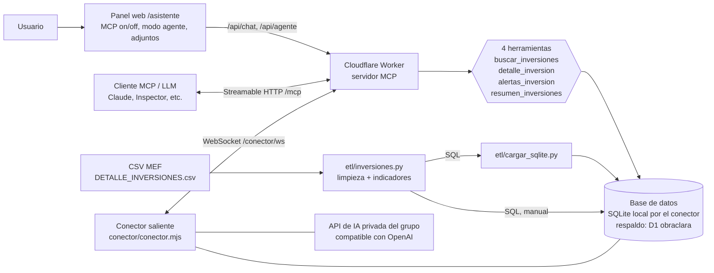

# ObraClara Perú

## En palabras sencillas

ObraClara es un sitio donde cualquiera puede preguntar, en castellano, por las obras públicas del Perú (colegios, hospitales, carreteras) y recibir una respuesta con la cifra oficial, la fuente y la fecha.

Un asistente de inteligencia artificial (un programa que conversa como un chat) normalmente responde de memoria, como alguien que contesta sin mirar ningún papel, y a veces inventa. Con ObraClara, el asistente primero consulta el registro oficial del Ministerio de Economía y Finanzas (MEF) y luego te cuenta lo que encontró. La conexión se hace con un «enchufe» estándar llamado MCP.

**Resultado:** de 40 preguntas, sin la conexión el asistente acertó 3 y con la conexión acertó las 40. Sin ella, 21 de las 40 respuestas traían cifras que no coinciden con el registro oficial; con ella, ninguna.

Las «alertas» (sobrecosto y posible paralización) son señales para revisar una obra con más atención; **no prueban irregularidades ni corrupción**.

**Glosario rápido:** *servidor* = programa siempre encendido que responde consultas; *base de datos* = archivo organizado para buscar rápido; *ETL* = limpiar y ordenar el archivo del MEF; *devengado* = gasto que el Estado reconoce como ya realizado; *monto viable* = lo que costaba la obra al aprobarse; *costo actualizado* = lo que cuesta hoy. El glosario completo está en [`docs/PROYECTO.md`](docs/PROYECTO.md#glosario).

- **Para exponer a un público sin conocimientos técnicos:** [`docs/EXPOSICION.md`](docs/EXPOSICION.md)
- **Referencias y documentos oficiales:** [`fuentes/REFERENCIAS.md`](fuentes/REFERENCIAS.md)

## Detalle técnico

Servidor MCP público (Model Context Protocol) que permite a un asistente de IA consultar datos de inversión pública del Perú (MEF): buscar obras, ver su detalle, detectar alertas y resumir por entidad o región. Proyecto del Grupo 1, curso I.A. Aplicada (ULima). Este repositorio es el código fuente del Anexo 01 del informe.

- **Documentación completa del proyecto:** [`docs/PROYECTO.md`](docs/PROYECTO.md) (misma información que la página `/proyecto`)
- **Sitio:** https://obraclara.adrielorihuela.net (inicio, `/proyecto`, `/datos`, `/asistente`, `/conectar`, `/acerca`; estado en `/salud`)
- **Servidor MCP:** https://obraclara.adrielorihuela.net/mcp (Streamable HTTP, pública, sin login)
- **Repositorio:** https://github.com/adrielorihuela/obraclara-mcp
- **Fuente de datos:** MEF, *Detalle de inversiones* (datos abiertos)

## Contenido del repositorio

| Carpeta | Qué contiene |
|---|---|
| `worker/` | Cloudflare Worker en TypeScript: servidor MCP (`src/server.ts`), consultas (`src/lib/queries.ts`), panel web y chat (`src/sitio/`, `src/demo.ts`, `src/lib/agente.ts`), pruebas (`test/`) |
| `etl/` | ETL en Python: `inversiones.py` (CSV a SQL), `cargar_sqlite.py` (SQLite local), `schema.sql` |
| `conector/` | Programa saliente que conecta el Worker con la IA y la base SQLite del grupo (`LEEME.md`) |
| `eval/` | Banco de 40 preguntas, ejecutor, puntuador y resultados; `exportar_sitio.mjs` genera los datos de la página `/proyecto` |
| `metricas/` | Mediciones de calidad de datos, alertas, rendimiento, exactitud y pruebas (`LEEME.md`); `exportar_sitio.mjs` genera los gráficos de `/proyecto` |
| `fuentes/` | `REFERENCIAS.md` (APA 7, enlace, qué respalda y dónde se usa) y copias de documentos oficiales de libre acceso |
| `docs/` | `PROYECTO.md` (documentación completa), `EXPOSICION.md` (guía para exponer sin tecnicismos) y capturas |
| `.github/workflows/` | `deploy.yml` (pruebas y despliegue), `etl.yml` (carga manual a D1) |

## Arquitectura



Flujo:

1. Fuente única: `DETALLE_INVERSIONES.csv` del MEF.
2. `etl/inversiones.py` limpia el CSV, calcula los indicadores y alertas con código determinista y genera SQL por lotes. El modelo de lenguaje **no calcula nada**.
3. Ese SQL se carga en una base **SQLite local** del grupo (`etl/cargar_sqlite.py`) y, de forma manual, en la base **D1 `obraclara`** de Cloudflare (respaldo, porque recargarla entera supera las escrituras diarias del plan gratuito).
4. El Worker (`worker/src/index.ts`) expone el servidor MCP en `/mcp`. Las cuatro herramientas consultan con SQL parametrizado: primero la SQLite local a través del conector y, si este no está conectado, D1 (`src/lib/remotedb.ts`). Límite de 60 solicitudes por minuto por cliente.
5. El **conector saliente** (`conector/`) abre un WebSocket hacia el Worker (no abre puertos), ejecuta los SELECT sobre la SQLite local y responde las preguntas del chat con la API de IA privada del grupo, compatible con OpenAI. Su dirección no está en el repositorio: se lee de la variable de entorno `IA_URL`.
6. El **panel web** (`/asistente`) ofrece un chat con interruptor **MCP activado/desactivado** (con MCP el modelo llama a las herramientas; sin MCP responde solo con su conocimiento), **modo agente** (`POST /api/agente`, tareas que pueden devolver archivos) y **adjuntos** (imágenes, documentos y proyectos; su texto se envía al modelo como «[Adjunto: ...]»). También permite configurar conexiones de IA propias.
7. Respaldo de emergencia del chat: si el conector no está disponible, el Worker responde con Workers AI y luego Groq (etiqueta «respaldo de ObraClara · modelo»).

## Herramientas MCP

Definidas en `worker/src/server.ts`; las consultas están en `worker/src/lib/queries.ts`. Filtros comunes (todos opcionales): `entidad` (se buscan todas las palabras, sin tildes ni mayúsculas), `departamento`, `funcion` (coincidencia exacta), `nivel` (`local`, `regional` o `nacional`). `limite`: entero de 1 a 20 (por defecto y máximo 20).

| Herramienta | Parámetros | Salida (`datos`) |
|---|---|---|
| `buscar_inversiones` | `texto?`, `entidad?`, `departamento?`, `funcion?`, `nivel?`, `limite?` | `{ total, mostrados, inversiones[] }` ordenadas por `costo_actualizado` descendente |
| `detalle_inversion` | `codigo_unico` (obligatorio) | Ficha completa o `null` si no existe (con un aviso) |
| `alertas_inversion` | `tipo` (obligatorio: `sobrecosto` o `paralizacion`), filtros comunes, `limite?` | `{ total, mostrados, inversiones[] }`; orden: `sobrecosto_pct` desc. (sobrecosto) o `meses_sin_devengado` y costo desc. (paralización) |
| `resumen_inversiones` | filtros comunes | `{ inversiones, costo_actualizado_total, devengado_anio_actual, saldo_por_ejecutar, alertas_sobrecosto, alertas_paralizacion }` |

Cada inversión de lista trae: `codigo_unico, nombre, entidad, nivel, departamento, funcion, costo_actualizado, monto_viable, avance_fisico, avance_ejecucion, ultimo_devengado, sobrecosto_pct, meses_sin_devengado, alerta_sobrecosto, alerta_paralizacion`. La ficha de `detalle_inversion` añade `sector, provincia, distrito, ubigeo, pim_anio, dev_anio, saldo_ejecutar, monto_laudo, fec_ini_ejecucion, fec_fin_ejecucion, situacion, habitantes`.

Toda respuesta es un JSON con `datos`, `fuente`, `url`, `fecha_descarga` y, en alertas, detalle y resumen, un `aviso`. Los errores se devuelven con `isError: true` y `{ "error": "..." }`.

## Procesamiento de datos

**`etl/inversiones.py`** (`python etl/inversiones.py --csv DETALLE_INVERSIONES.csv --out build --fecha AAAA-MM-DD`):

- **Lectura:** CSV en UTF-8 (con o sin BOM). Se leen estas columnas del MEF: `CODIGO_UNICO, NOMBRE_INVERSION, ENTIDAD, NIVEL, SECTOR, FUNCION, DEPARTAMENTO, PROVINCIA, DISTRITO, UBIGEO, MONTO_VIABLE, COSTO_ACTUALIZADO, PIM_ANIO_ACTUAL, DEV_ANIO_ACTUAL, SALDO_EJECUTAR, MONTO_LAUDO, AVANCE_FISICO, AVANCE_EJECUCION, ULTIMO_DEVENGADO, FEC_INI_EJECUCION, FEC_FIN_EJECUCION, SITUACION, NUM_HABITANTES_BENEF`.
- **Limpieza:** se quitan espacios; los códigos únicos repetidos se descartan (queda el primero); los montos y avances se convierten a número (vacío o no numérico pasa a `NULL`); las fechas se recortan a `AAAA-MM-DD`; `habitantes` pasa a entero.
- **Columnas de búsqueda:** `entidad_n`, `funcion_n`, `departamento_n` (sin tildes y en mayúsculas) y `busqueda` (nombre + entidad + distrito + provincia normalizados).
- **Indicadores y alertas** (`--fecha` es la fecha de descarga, que se usa como referencia del cálculo):
  - `sobrecosto_pct = round((costo_actualizado − monto_viable) / monto_viable × 100, 2)`, solo si `monto_viable > 0`.
  - `alerta_sobrecosto = 1` si `sobrecosto_pct ≥ 50`.
  - `meses_sin_devengado = (año_ref − año_ultimo_devengado) × 12 + (mes_ref − mes_ultimo_devengado)`, con `ULTIMO_DEVENGADO` en formato `AAAAMM`.
  - `alerta_paralizacion = 1` si `40 ≤ avance_fisico < 100` **y** `meses_sin_devengado ≥ 6`.
- **Salida:** `build/data_000.sql, data_001.sql, …` (INSERT por lotes de 40 filas, 4000 filas por archivo) y `build/meta.sql` (`fecha_descarga`, `total_inversiones`, `alertas_sobrecosto`, `alertas_paralizacion`, `fuente`, `url`).

**`etl/cargar_sqlite.py`** (`python etl/cargar_sqlite.py --build build --db ~/.local/share/obraclara/inversiones.db`): crea la base con `etl/schema.sql` (tablas `inversiones` y `meta`, e índices por entidad, departamento, función, nivel y alertas), ejecuta `data_*.sql` y `meta.sql`, corre `ANALYZE` y reemplaza la base anterior de forma atómica.

**Aviso:** las alertas son **indicios técnicos calculados con datos abiertos**, no la determinación oficial de la Ley 31589 ni prueba de irregularidades. La posible paralización es solo una aproximación (avance físico y último mes con gasto devengado). Cualquier hallazgo debe verificarse en la fuente oficial.

## Prompts utilizados

### 1. Instrucciones del servidor MCP (`worker/src/server.ts`, `INSTRUCCIONES`)

```text
ObraClara Perú consulta las inversiones públicas activas del Ministerio de Economía y Finanzas (MEF, Banco de Inversiones).
Reglas para responder:
1. Cita siempre la fuente y la fecha_descarga que devuelve cada herramienta.
2. Si una herramienta devuelve cero resultados o un error, dilo; no supongas ni completes cifras.
3. Los montos están en soles (S/). No hagas cálculos propios: usa los campos que entrega el servidor.
4. Las alertas (sobrecosto, posible paralización) son indicios técnicos para orientar la revisión. No prueban irregularidades ni corrupción.
5. La alerta de posible paralización es una aproximación de la Ley 31589: usa el avance físico y el último mes con gasto devengado.
```

### 2. Descripciones de las herramientas (`worker/src/server.ts`)

- `buscar_inversiones`: «Busca inversiones públicas activas del MEF por texto libre (nombre de la obra, distrito, provincia) y filtros opcionales. Devuelve hasta 20, ordenadas por costo actualizado.»
- `detalle_inversion`: «Devuelve la ficha completa de una inversión a partir de su código único: montos, avance físico y de ejecución, último devengado, fechas, ubicación y alertas.»
- `alertas_inversion`: «Lista inversiones con alerta. 'sobrecosto': (costo actualizado - monto viable) / monto viable >= 50 %. 'paralizacion': avance físico entre 40 % y 99 % y 6 meses o más sin gasto devengado. Son indicios, no prueba de irregularidades.»
- `resumen_inversiones`: «Resume un conjunto de inversiones: cantidad, costo actualizado total, devengado del año, saldo por ejecutar y cantidad de alertas de cada tipo. Filtra por entidad, departamento, función o nivel.»

Descripciones de parámetros: `entidad` «Nombre o parte del nombre de la entidad, por ejemplo 'Municipalidad Provincial de Piura'»; `departamento` «Departamento, por ejemplo 'Cusco'»; `funcion` «Función exacta (sin importar tildes ni mayúsculas): Transporte, Educación, Saneamiento, …» (lista completa en el código); `nivel` «Nivel de gobierno: local, regional o nacional»; `texto` «Palabras del nombre de la inversión o del lugar»; `codigo_unico` «Código único de la inversión, por ejemplo '2716769'»; `limite` «Cantidad máxima de resultados (por defecto y máximo 20)».

Aviso que acompaña a las alertas: «Las alertas son indicios técnicos, no prueban irregularidades. La posible paralización usa el avance físico y el último mes con gasto devengado, como aproximación de la Ley 31589.»

### 3. Prompt de sistema del chat del panel (`worker/src/lib/agente.ts`, `buildSystemPrompt`)

Fragmento común a ambos modos (constante `archivos`):

````text
Si el usuario pide un archivo o documento (Word, PDF, código, texto, un proyecto), escríbelo completo en un bloque de código cuya línea de apertura sea ```archivo:ruta/nombre.ext (por ejemplo ```archivo:informe.md o ```archivo:src/app.py), un bloque por archivo; si el contenido lleva bloques de código propios, abre y cierra el bloque archivo con cuatro acentos graves. Para Word o PDF escribe el contenido en Markdown simple dentro de ```archivo:nombre.docx o ```archivo:nombre.pdf: el sitio ofrece botones de descarga. Añade una frase que diga qué contiene cada archivo.
````

**Sin MCP** (`mcpOn = false`):

```text
Responde en español. Si la pregunta trata de datos oficiales del Perú, cita la fuente y no inventes cifras. Si el usuario adjunta una imagen, descríbela con lo que se ve. Si adjunta documentos o proyectos, su texto viene en el mensaje bajo «[Adjunto: ...]»: úsalo como contexto. <archivos>
```

**Con MCP** (`mcpOn = true`; `<lista de herramientas>` se genera a partir de lo que devuelve `tools/list` del servidor, con una línea `- nombre: descripción` y otra `Parámetros: nombre (tipo, obligatorio): descripción; ...` por herramienta):

```text
Eres ObraClara, asistente de datos de inversión pública del Perú (fuente: MEF). Respondes en español.
Tienes estas herramientas:
<lista de herramientas>
Protocolo: para llamar una herramienta responde SOLO con JSON, sin texto adicional: {"tool":"<nombre>","args":{...}}.
Recibirás el resultado y podrás llamar otra herramienta o terminar. Para terminar responde SOLO con JSON: {"respuesta":"<respuesta final en español, citando fuente y fecha_descarga>"}.
Nunca inventes datos: usa únicamente lo que devuelvan las herramientas. Las alertas son indicadores técnicos, no prueban irregularidades.
Si el usuario adjunta documentos o proyectos, su texto viene en el mensaje bajo «[Adjunto: ...]»: úsalo como contexto.
<archivos> El bloque va dentro del texto de "respuesta": escribe los saltos de línea como \n y escapa las comillas dobles como \".
```

### 4. Prompts de la evaluación (`eval/run_eval.mjs`)

**Condición sin MCP** (`SYS_A`):

```text
Responde en español, con datos oficiales del Perú y cita la fuente.
```

**Condición con MCP** (`sysB`; `${toolsText(tools)}` lista cada herramienta con sus parámetros, tipo, si es obligatorio u opcional y su descripción; `${MAX_STEPS}` vale 5):

```text
Eres un asistente que responde preguntas sobre inversión pública del Perú usando herramientas de ObraClara (datos del MEF).
Esta conversación la lee un programa conectado al servidor ObraClara: cuando respondes con un JSON {"tool":...}, el programa ejecuta esa herramienta de verdad y te envía el resultado en el siguiente mensaje. Por lo tanto SÍ tienes acceso a las herramientas a través de este protocolo; no digas que no tienes acceso. Empieza llamando a la herramienta adecuada.
Herramientas disponibles:
${toolsText(tools)}

Protocolo (obligatorio):
1. Para llamar a una herramienta responde SOLO con un objeto JSON, sin texto adicional: {"tool":"<nombre>","args":{...}}
2. Recibirás el resultado de la herramienta en el siguiente mensaje; entonces continúa (puedes llamar a otra herramienta).
3. Cuando termines responde SOLO con un objeto JSON: {"respuesta":"<respuesta final en español, citando la fuente y la fecha_descarga que devolvió la herramienta>"}
4. Si una herramienta no devuelve datos, dilo; no inventes cifras ni códigos.
Tienes como máximo ${MAX_STEPS} pasos.
```

El mensaje de usuario es la pregunta de `eval/preguntas.csv`, sin añadidos.

## Evaluación

Carpeta `eval/`. Método: 40 preguntas (`preguntas.csv`, 10 de cada tipo: búsqueda, detalle, alertas, resumen) con valor oficial verificado contra el CSV del MEF (`verificar_referencias.py`, `verificar_csv_pandas.py`). Cada pregunta se hace en dos condiciones, **sin MCP** (el modelo responde solo) y **con MCP** (el modelo llama a las herramientas del servidor público, hasta 5 pasos). Una sola corrida por condición.

Métricas (porcentaje sobre las 40 preguntas): **exactitud** (el valor numérico o la entidad coincide con la referencia, ±1 %), **citación** (menciona la fuente MEF y la fecha de corte o de descarga), **inventada** (da cifras que no coinciden con la referencia), y dos medidas más exigentes añadidas tras una revisión externa: **exacta estricta** (es exacta y ninguna cifra relevante de la respuesta, porcentaje o monto desde 1 000, queda sin sustento en los resultados de las herramientas o en la referencia) y **cifras no sustentadas** (respuestas con al menos una cifra así). Con la regla estricta: sin MCP 5 % (2 de 40) y con MCP 98 % (39 de 40); cifras no sustentadas: 55 % y 3 %. La exacta original basta con que *una* cifra coincida, por eso sobrestima (caso D04 con MCP). El puntuador es automático y de reglas simples; no entiende el contexto de cada cifra. Se informan además mediana y p90 de latencia (los máximos de más de 300 s se deben a reintentos). Además: latencia, llamadas por pregunta y casos «revisar» para verificación manual. Las reglas exactas están en `eval/resultados/resumen.md` y en `eval/score_eval.mjs`.

```bash
cd eval
export IA_URL=http://<host>:<puerto>      # API de IA privada del grupo, compatible con OpenAI (obligatoria)
# opcionales: IA_KEY, IA_MODELO
node run_eval.mjs                          # ejecuta ambas condiciones; reanudable; opciones --solo sin_mcp|con_mcp, --ids B01,B02, --max N
node reconstruir_fuentes.mjs               # (solo si faltan) reproduce los resultados de las herramientas ya registradas; no consulta a la IA
node score_eval.mjs                        # puntúa y escribe resultados/resultados.csv y resultados/resumen.md
```

Resultados: [`eval/resultados/resumen.md`](eval/resultados/resumen.md). Las respuestas crudas están en `eval/resultados/raw_*.jsonl`; los resultados de las herramientas, en `fuentes_con_mcp.json`. Pruebas del puntuador: `node --test eval/cifras.test.mjs`.

### Tablas para gráficos en Excel

```bash
cd eval
node exportar_graficos.mjs
node exportar_sitio.mjs      # actualiza worker/src/sitio/evaluacion-datos.ts (gráficos de /proyecto)
```

Lee `eval/resultados/resultados.csv` (generado por `score_eval.mjs`) y escribe en `eval/resultados/`: `graficos_global.csv` (exactitud, citación, inventada, ejecutadas, exacta estricta y no sustentadas por condición), `graficos_por_tipo.csv` (lo mismo por tipo y condición) y `graficos_latencia.csv` (latencia media, mediana, p90 y máximo por condición). Los porcentajes usan el mismo criterio que `resumen.md` (sobre 40 preguntas por condición, 10 por tipo).

## Pruebas

```bash
cd worker
npm ci
npx vitest run            # 104 pruebas en 9 archivos, todas pasan
npx tsc --noEmit          # verificación de tipos, sin errores
npx wrangler deploy --dry-run   # empaqueta el Worker sin desplegar
```

Cobertura de las 104 pruebas (`worker/test/`): `adjuntos` (27: lectura de ZIP, texto frente a binario, documentos), `agente` (32: análisis de las llamadas JSON a herramientas, flujo SSE y protocolo del chat), `queries` (14: normalización, `buscar`, `detalle`, `alertas`, `resumen` sobre una D1 simulada), `cadena` (13: cadena de proveedores de IA y validación con imágenes), `agenteapi` (4), `remotedb` (4: la consulta usa el conector y cae a D1 si no responde), `mcp` (3: lista exactamente las 4 herramientas, cada respuesta trae datos, fuente, URL y fecha, y se informa cuando no hay resultados) `gptjobs` (2: validación de mensajes) y `sitio` (5: la página `/proyecto` y que el sitio no exponga datos internos).

Prueba manual contra el servidor público con MCP Inspector:

```bash
npx @modelcontextprotocol/inspector
# Transporte: Streamable HTTP · URL: https://obraclara.adrielorihuela.net/mcp
# Pestaña Tools: List Tools (4 herramientas) y ejecutar, por ejemplo, alertas_inversion con tipo = paralizacion
```

## Cómo reproducir

**Requisitos:** Node 22 o superior, Python 3.12, y una cuenta de Cloudflare (plan gratuito basta) con Wrangler (`npx wrangler login` o `CLOUDFLARE_API_TOKEN` y `CLOUDFLARE_ACCOUNT_ID` en el entorno).

1. **Descargar el CSV del MEF** (~248 MB):
   ```bash
   curl -fSL -o DETALLE_INVERSIONES.csv https://fs.datosabiertos.mef.gob.pe/datastorefiles/DETALLE_INVERSIONES.csv
   ```
2. **ETL** (genera `build/data_*.sql` y `build/meta.sql`):
   ```bash
   python etl/inversiones.py --csv DETALLE_INVERSIONES.csv --out build --fecha "$(date +%F)"
   ```
3. **Cargar la base.** Opción A, SQLite local (la usa el conector):
   ```bash
   python etl/cargar_sqlite.py --build build --db ~/.local/share/obraclara/inversiones.db
   ```
   Opción B, D1 de Cloudflare (desde `worker/`; crear antes la base con `npx wrangler d1 create obraclara` y poner su `database_id` en `worker/wrangler.jsonc`). Cargar primero el esquema, luego `meta.sql` y después cada `data_*.sql` en orden:
   ```bash
   cd worker
   npx wrangler d1 execute obraclara --remote --yes --file ../etl/schema.sql
   npx wrangler d1 execute obraclara --remote --yes --file ../build/meta.sql
   for f in $(ls ../build/data_*.sql | sort); do npx wrangler d1 execute obraclara --remote --yes --file "$f"; done
   ```
   El workflow manual `.github/workflows/etl.yml` automatiza la opción B. La recarga vacía brevemente la tabla (el esquema hace DROP y recrea).
4. **Probar y desplegar el Worker** (ajustar `routes` en `worker/wrangler.jsonc` a un dominio propio o quitarlo para usar `*.workers.dev`):
   ```bash
   cd worker
   npm ci && npx vitest run && npx tsc --noEmit
   npx wrangler dev          # servidor local en http://localhost:8787/mcp
   npx wrangler deploy
   ```
5. **Secretos** (solo por nombre; los valores no están en el repositorio):
   - `CONECTOR_SECRET` (obligatorio para el conector y el chat con IA propia): `npx wrangler secret put CONECTOR_SECRET`. Es el mismo valor que usa el conector.
   - `GROQ_API_KEY` (opcional): respaldo del chat con Groq.
   - Para el despliegue desde GitHub Actions: `CLOUDFLARE_API_TOKEN`, `CLOUDFLARE_ACCOUNT_ID` y `CONECTOR_SECRET` como secretos del repositorio.
   - Sin conector, el servidor MCP funciona igual con D1 y el chat usa Workers AI.
6. **Conector (opcional)** en el equipo que tenga la IA y la SQLite. Crear `~/.config/obraclara/conector.env` (fuera de git):
   ```bash
   IA_URL=http://<host>:<puerto>           # API compatible con OpenAI (obligatoria)
   IA_KEY=                                 # opcional
   IA_MODELO=                              # opcional
   CONECTOR_SECRET_FILE=/ruta/al/secreto   # mismo valor que el secreto CONECTOR_SECRET del Worker
   DB_PATH=~/.local/share/obraclara/inversiones.db
   ```
   ```bash
   set -a; . ~/.config/obraclara/conector.env; set +a
   node conector/conector.mjs
   ```
   Más detalles (servicio systemd, modo agente) en [`conector/LEEME.md`](conector/LEEME.md).

## Cómo conectar el servidor a un cliente MCP

URL: `https://obraclara.adrielorihuela.net/mcp` (Streamable HTTP, sin autenticación).

- **claude.ai:** Configuración > Conectores > Agregar conector personalizado, pegar la URL.
- **Claude Code:** `claude mcp add --transport http obraclara https://obraclara.adrielorihuela.net/mcp`
- **Claude Desktop:** conector personalizado con la misma URL.
- **MCP Inspector:** `npx @modelcontextprotocol/inspector`, transporte *Streamable HTTP* y la URL anterior.
- **Otros clientes:** cualquiera que soporte MCP por HTTP; en configuración JSON, `{ "mcpServers": { "obraclara": { "type": "http", "url": "https://obraclara.adrielorihuela.net/mcp" } } }`.

## Uso de IA

El código fue desarrollado con ayuda de IA generativa (vibe coding) y **revisado y probado por el grupo** (pruebas automáticas, verificación de tipos, evaluación contra datos oficiales). El informe y los gráficos fueron redactados y elaborados por el grupo. En el chat del panel, el modelo solo redacta: todas las cifras y alertas salen de las herramientas y del ETL.

## Datos y licencia

- **Datos:** Ministerio de Economía y Finanzas (MEF), *Información de inversiones públicas 2001-2026* (Detalle de inversiones), datos abiertos bajo licencia ODC-BY. Atribución: «Fuente: MEF, Datos Abiertos». Portal: https://www.datosabiertos.gob.pe
- **Código:** licencia MIT (ver [LICENSE](LICENSE)).

## Limitaciones

- Los datos corresponden a la fecha de descarga que informa cada respuesta (`fecha_descarga`); pueden no reflejar el estado más reciente en el MEF.
- La recarga de D1 vacía brevemente la tabla, por lo que durante unos minutos las consultas a D1 pueden devolver pocos o ningún resultado.
- Las alertas son aproximaciones y no prueban irregularidades.
- La evaluación es de una sola corrida y su puntuación es automática (ver advertencias en `eval/resultados/resumen.md`).
