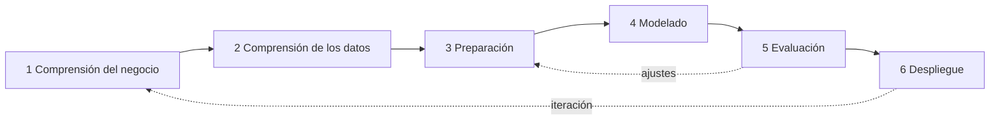
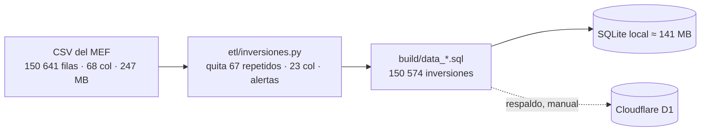
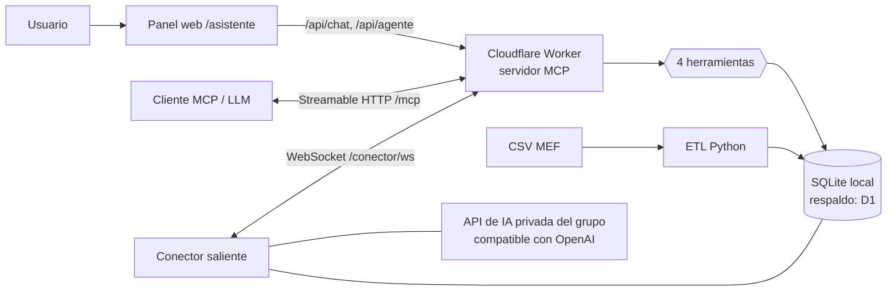
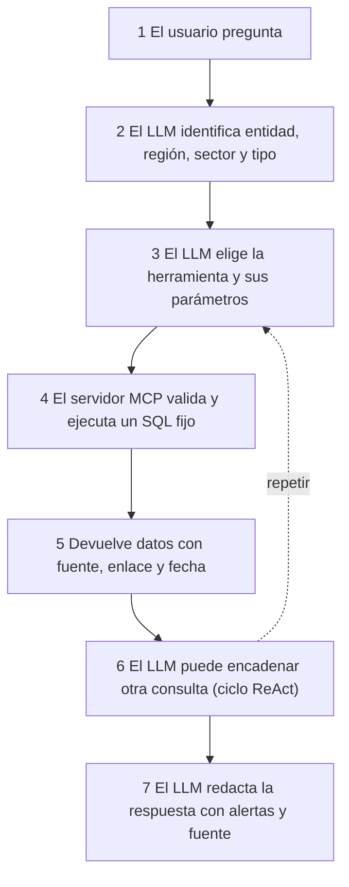
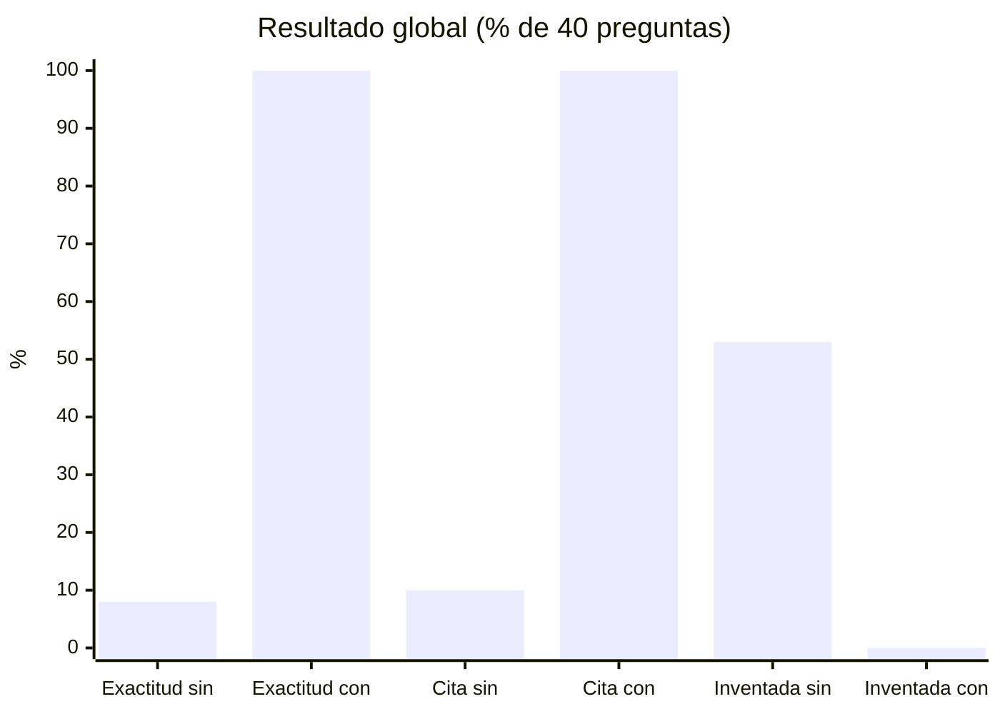

# ObraClara Perú: el proyecto

Misma información que la página [`/proyecto`](https://obraclara.adrielorihuela.net/proyecto) del sitio. Proyecto del Grupo 1, I.A. Aplicada (sección 356), Universidad de Lima, 2026-2.

## Contenido

1. [Problema y contexto](#1-problema-y-contexto) · 2. [Objetivo y alcance](#2-objetivo-y-alcance) · 3. [ODS 16](#3-ods-16) · 4. [Metodología CRISP-DM](#4-metodología-crisp-dm) · 5. [Datos y ETL](#5-datos-y-etl) · 6. [Criterios de alerta](#6-criterios-de-alerta) · 7. [Arquitectura](#7-arquitectura) · 8. [Herramientas](#8-las-4-herramientas) · 9. [Tecnologías](#9-tecnologías) · 10. [Evaluación](#10-evaluación) · 11. [Pruebas](#11-pruebas) · 12. [Limitaciones](#12-limitaciones-y-trabajo-futuro) · 13. [Uso de IA](#13-uso-de-ia) · 14. [Referencias](#14-referencias) · 15. [Enlaces](#15-enlaces)

## 1. Problema y contexto

Según la Nota Informativa N.° 02 del MEF (julio de 2026), con datos a marzo de 2026, hay **684 inversiones vinculadas a obras paralizadas** (MEF, 2026a).

| Indicador | Valor |
|---|---|
| Costo actualizado | S/ 21 141 millones |
| Devengado | S/ 13 100 millones |
| Saldo por ejecutar | S/ 8 041 millones |

| Nivel de gobierno | Inversiones | Parte |
|---|---|---|
| Gobiernos locales | 511 | 75 % |
| Gobierno nacional | 93 (saldo S/ 4 364 M, 54,3 % del saldo) | 13,6 % |
| Gobiernos regionales | 80 | 11,7 % |

Causas principales: falta de recursos financieros, 109 inversiones (15,9 %); incumplimiento de contrato, 106 (15,5 %).

Los datos son abiertos pero difíciles de usar: Janssen et al. (2012) advierten que publicar datos no basta, porque hay barreras técnicas y de uso; Wirtz et al. (2022) dan un marco para analizarlas. Quien quiere saber cómo va una obra debe descargar un archivo de cientos de MB, entender PIM, devengado o CUI y filtrar a mano.

## 2. Objetivo y alcance

**Objetivo general.** Facilitar el acceso a la información oficial de inversión pública del Perú mediante un servidor MCP público que permita a un asistente de IA buscar obras, ver su detalle, detectar alertas y resumir por entidad o región, con respuestas que citan la fuente y la fecha.

- Una sola fuente oficial: `DETALLE_INVERSIONES.csv` del MEF (ODC-BY).
- Cuatro herramientas: buscar, detalle, alertas y resumen.
- Las alertas son indicios, no prueba de irregularidades.
- El modelo no calcula: los indicadores salen del ETL.

## 3. ODS 16

| Meta | Texto | Relación |
|---|---|---|
| 16.6 | Crear a todos los niveles instituciones eficaces y transparentes que rindan cuentas | Directa |
| 16.10 | Garantizar el acceso público a la información | Directa |
| 16.5 | Reducir considerablemente la corrupción y el soborno en todas sus formas | Indirecta (las alertas no prueban irregularidades) |

## 4. Metodología CRISP-DM

| Fase | En este proyecto |
|---|---|
| 1. Comprensión del negocio | Obras paralizadas, usuarios (ciudadanos, periodistas, regidores) y ODS 16 |
| 2. Comprensión de los datos | Estructura (68 columnas), tamaño (150 641 filas, 247 MB), licencia ODC-BY y calidad (67 códigos repetidos, vacíos) |
| 3. Preparación | ETL en Python: limpieza, 23 columnas, indicadores, alertas y carga a SQLite y D1 |
| 4. Modelado | Diseño de las 4 herramientas MCP y del formato de respuesta |
| 5. Evaluación | 40 preguntas sin y con MCP |
| 6. Despliegue | Cloudflare, pruebas, documentación y sitio |

## 5. Datos y ETL

Descarga del 10 de noviembre de 2026 (archivo modificado el 8 de noviembre): **150 641 filas, 68 columnas, 247 MB**. 67 códigos únicos repetidos: se conserva la primera fila, quedan **150 574 inversiones**. Se conservan **23 columnas**; la base SQLite pesa unos 141 MB. Licencia ODC-BY.

| Bloque | Columnas del CSV |
|---|---|
| Identificación (2) | `CODIGO_UNICO`, `NOMBRE_INVERSION` |
| Responsable y ubicación (9) | `ENTIDAD`, `NIVEL`, `SECTOR`, `FUNCION`, `DEPARTAMENTO`, `PROVINCIA`, `DISTRITO`, `UBIGEO`, `NUM_HABITANTES_BENEF` |
| Montos (6) | `MONTO_VIABLE`, `COSTO_ACTUALIZADO`, `PIM_ANIO_ACTUAL`, `DEV_ANIO_ACTUAL`, `SALDO_EJECUTAR`, `MONTO_LAUDO` |
| Estado (6) | `AVANCE_FISICO`, `AVANCE_EJECUCION`, `ULTIMO_DEVENGADO`, `FEC_INI_EJECUCION`, `FEC_FIN_EJECUCION`, `SITUACION` |

Columnas derivadas: `sobrecosto_pct`, `meses_sin_devengado`, `alerta_sobrecosto`, `alerta_paralizacion`, y de búsqueda `busqueda`, `entidad_n`, `funcion_n`, `departamento_n`.

## 6. Criterios de alerta

- **Sobrecosto:** `(COSTO_ACTUALIZADO − MONTO_VIABLE) / MONTO_VIABLE ≥ 0,50`, con `MONTO_VIABLE > 0`.
- **Posible paralización:** `40 % ≤ AVANCE_FISICO < 100 %` y `meses desde ULTIMO_DEVENGADO ≥ 6`.

Base: Ley N.° 31589, que considera paralizada una obra por contrata con avance físico ≥ 40 % y seis meses o más sin ejecución física, o con contrato resuelto o nulo; en administración directa el avance mínimo es 50 % (Congreso de la República, 2022). Es una aproximación porque el archivo solo trae el último mes con gasto devengado (financiero, no físico), no distingue contrata de administración directa, no informa contratos resueltos ni declaraciones, e incluye todas las inversiones activas y no solo obras.

Cifras al corte del 10/11/2026 (API pública `/api/alertas` y `/salud`): **16 502** con posible paralización (11,0 % de 150 574) y **26 387** con sobrecosto ≥ 50 % (17,5 %). Frente a las 684 del inventario oficial (unas 24 veces menos): el universo es distinto (todas las inversiones activas), el indicador es distinto (gasto, no situación de la obra), no se distingue modalidad ni declaración, las fechas difieren (marzo frente a noviembre de 2026) y puede haber meses sin gasto por motivos administrativos. Sirven para priorizar revisiones, no para contar obras paralizadas.

## 7. Arquitectura

Las siete etapas de una consulta:

## 8. Las 4 herramientas

Filtros comunes (opcionales): `entidad`, `departamento`, `funcion`, `nivel` (local, regional o nacional); `limite` de 1 a 20. Toda respuesta trae `datos`, `fuente`, `url`, `fecha_descarga` y, según el caso, `aviso`.

| Herramienta | Parámetros | Salida | Ejemplo real (corte 10/11/2026) |
|---|---|---|---|
| `buscar_inversiones` | `texto?`, filtros, `limite?` | `{ total, mostrados, inversiones[] }` | Transporte, Cusco, regional: total 74 |
| `detalle_inversion` | `codigo_unico` | ficha completa o `null` | `2507146`: Hospital de Alta Complejidad (Piura), S/ 955 063 507,44 |
| `alertas_inversion` | `tipo` (`sobrecosto` o `paralizacion`), filtros, `limite?` | `{ total, mostrados, inversiones[] }` | paralización en Ayacucho: total 815 |
| `resumen_inversiones` | filtros | `{ inversiones, costo_actualizado_total, devengado_anio_actual, saldo_por_ejecutar, alertas_sobrecosto, alertas_paralizacion }` | Moquegua: 1 767 inversiones, S/ 20 049 064 306,37 |

## 9. Tecnologías

TypeScript y Zod; Cloudflare Workers, D1 y Durable Objects; MCP SDK y Agents SDK (`createMcpHandler`); Streamable HTTP; Python 3.12 (ETL); SQLite; Vitest; GitHub Actions. IA del servidor (API de IA privada del grupo, compatible con OpenAI) con respaldo de Workers AI y Groq.

## 10. Evaluación

**Método.** 40 preguntas (10 de búsqueda, 10 de detalle, 10 de alertas y 10 de resumen) con referencia verificada contra el CSV antes de correr; las mismas preguntas sin y con MCP (hasta 5 pasos); una corrida (R02, R03 y R07–R10 el 18/11/2026; el resto el 10/11/2026).

- **Exactitud** = exactas / 40 × 100 (número a ±1 % del oficial, o entidad esperada).
- **Citación** = respuestas que mencionan MEF o el dataset y la fecha / 40 × 100.
- **Inventada** = respuestas con cifras que no coinciden, resultados donde no hay datos u otra entidad / 40 × 100.

**Resultado global** (`eval/resultados/graficos_global.csv` y `resumen.md`)

| Condición | Exacta | Cita | Inventada | Revisar | Latencia total | Sin reintentos | Llamadas | Ejecutadas |
|---|---|---|---|---|---|---|---|---|
| Sin MCP | 8 % | 10 % | 53 % | 20 | 22,1 s | 11,1 s | 0,0 | 40/40 |
| Con MCP | 100 % | 100 % | 0 % | 0 | 99,9 s | 20,2 s | 1,0 | 40/40 |

La herramienta esperada se usó en 37 de 40 preguntas con MCP.

**Por tipo** (`graficos_por_tipo.csv`)

| Tipo | Exacta sin / con | Cita sin / con | Inventada sin / con |
|---|---|---|---|
| Búsqueda | 0 % / 100 % | 0 % / 100 % | 80 % / 0 % |
| Detalle | 20 % / 100 % | 30 % / 100 % | 20 % / 0 % |
| Alertas | 0 % / 100 % | 0 % / 100 % | 70 % / 0 % |
| Resumen | 10 % / 100 % | 10 % / 100 % | 40 % / 0 % |

**Latencia media** (`graficos_latencia.csv`): 22,1 s sin MCP y 99,9 s con MCP (con reintentos; el proveedor a veces tardó hasta 3 minutos).

**Ejemplos reales** (recortados, de `raw_*.jsonl`)

| Pregunta (referencia) | Sin MCP | Con MCP |
|---|---|---|
| B01 ¿Cuántos proyectos de transporte tiene el Gobierno Regional en Cusco? (74) | «…cuenta con una cartera de 56 inversiones e intervenciones en transporte…» (no exacta, inventada) | «…tiene 74 proyectos de inversión pública en la función Transporte registrados en el MEF…» (exacta, cita) |
| A01 ¿Cuántas obras de Ayacucho podrían estar paralizadas? (815) | «Según la Contraloría…, en Ayacucho se registraban 150 obras públicas paralizadas al 30 de junio de 2026.» (no exacta, inventada) | «…se identifican 815 inversiones públicas con posibles indicios de paralización…» (exacta, cita) |
| R01 ¿Cuánto suman las inversiones registradas en Moquegua? (S/ 20 049 064 306,37) | Reparte por nivel de gobierno con otras cifras (no exacta, inventada) | «…suman un costo actualizado total de S/ 20,049,064,306.37… 1,767 inversiones…» (exacta, cita) |

**Limitaciones** (de `resumen.md`): proveedor de IA gratuito con límite de uso y modelo no controlado (sin MCP puede usar búsqueda web); protocolo de herramientas en texto y resultados de más de 15 000 caracteres recortados; puntuación automática con reglas simples (los casos «revisar» requieren revisión manual); la latencia incluye reintentos; «inventada» es una cota superior (sin MCP el chat cita fuentes reales de otras fechas); el marcado interno del proveedor afecta sobre todo a «cita» sin MCP; las abstenciones no cuentan como exactas ni inventadas; una sola corrida por condición; referencia con corte 2026-11-10.

Para regenerar los datos del sitio: `node eval/exportar_sitio.mjs`.

## 11. Pruebas

**104 pruebas en 9 archivos** (`cd worker && npx vitest run`), todas pasan; además `npx tsc --noEmit` y `npx wrangler deploy --dry-run`.

| Archivo | Pruebas | Qué cubre |
|---|---|---|
| `adjuntos` | 27 | ZIP, texto frente a binario, documentos |
| `agente` | 32 | llamadas JSON a herramientas, SSE y protocolo del chat |
| `queries` | 14 | normalización, buscar, detalle, alertas y resumen sobre D1 simulada |
| `cadena` | 13 | cadena de proveedores de IA y validación con imágenes |
| `agenteapi` | 4 | validación de la API del modo agente |
| `remotedb` | 4 | usa el conector y cae a D1 si no responde |
| `mcp` | 3 | 4 herramientas, respuesta con datos, fuente, URL y fecha, sin resultados |
| `gptjobs` | 2 | validación de mensajes |
| `sitio` | 5 | `/proyecto` responde con todas las secciones, cifras y gráficos accesibles |

## 12. Limitaciones y trabajo futuro

- Datos a la fecha de descarga; alertas aproximadas; D1 queda vacía unos minutos durante la recarga; la IA del servidor es compartida y puede estar apagada; evaluación de una sola corrida con puntuación automática.
- Futuro: repetir la evaluación y revisar a mano los casos «revisar»; acercar la alerta de paralización a la ley (modalidad y avance físico reciente); otras fuentes oficiales para contrastar; llamadas nativas a herramientas.

## 13. Uso de IA

El código se desarrolló con ayuda de IA generativa y fue revisado y probado por el grupo. La redacción del informe, el workflow, los gráficos del informe y el póster los hace el grupo sin IA. En el chat, el modelo solo redacta: las cifras salen de las herramientas y del ETL.

## 14. Referencias

- Brown, T. B., Mann, B., Ryder, N., Subbiah, M., Kaplan, J., Dhariwal, P., Neelakantan, A., Shyam, P., Sastry, G., Askell, A., Agarwal, S., Herbert-Voss, A., Krueger, G., Henighan, T., Child, R., Ramesh, A., Ziegler, D. M., Wu, J., Winter, C., . . . Amodei, D. (2020). Language models are few-shot learners. En *Advances in Neural Information Processing Systems* (Vol. 33). <https://arxiv.org/abs/2005.14165>
- Congreso de la República. (2022). *Ley N.° 31589*.
- Es, S., James, J., Espinosa Anke, L., & Schockaert, S. (2024). RAGAs: Automated evaluation of retrieval augmented generation. En *Proceedings of the 18th Conference of the European Chapter of the Association for Computational Linguistics: System Demonstrations* (pp. 150–158). <https://doi.org/10.18653/v1/2024.eacl-demo.16>
- Gao, Y., Xiong, Y., Gao, X., Jia, K., Pan, J., Bi, Y., Dai, Y., Sun, J., Wang, M., & Wang, H. (2023). *Retrieval-augmented generation for large language models: A survey*. arXiv. <https://arxiv.org/abs/2312.10997>
- Hou, X., Zhao, Y., Wang, S., & Wang, H. (2025). *Model Context Protocol (MCP): Landscape, security threats, and future research directions*. arXiv. <https://arxiv.org/abs/2503.23278>
- Janssen, M., Charalabidis, Y., & Zuiderwijk, A. (2012). Benefits, adoption barriers and myths of open data and open government. *Information Systems Management, 29*(4), 258–268. <https://doi.org/10.1080/10580530.2012.716740>
- Ji, Z., Lee, N., Frieske, R., Yu, T., Su, D., Xu, Y., Ishii, E., Bang, Y. J., Madotto, A., & Fung, P. (2023). Survey of hallucination in natural language generation. *ACM Computing Surveys, 55*(12), 1–38. <https://doi.org/10.1145/3571730>
- Lewis, P., Perez, E., Piktus, A., Petroni, F., Karpukhin, V., Goyal, N., Küttler, H., Lewis, M., Yih, W.-t., Rocktäschel, T., Riedel, S., & Kiela, D. (2020). Retrieval-augmented generation for knowledge-intensive NLP tasks. En *Advances in Neural Information Processing Systems* (Vol. 33). <https://arxiv.org/abs/2005.11401>
- Li, J., Hui, B., Qu, G., Yang, J., Li, B., Li, B., Wang, B., Qin, B., Cao, R., Geng, R., Huo, N., Zhou, X., Ma, C., Li, G., Chang, K. C. C., Huang, F., Cheng, R., & Li, Y. (2023). Can LLM already serve as a database interface? A BIg bench for large-scale database grounded text-to-SQLs. En *Advances in Neural Information Processing Systems* (Vol. 36). <https://arxiv.org/abs/2305.03111>
- Ministerio de Economía y Finanzas. (2026a). *Nota Informativa N.° 02* [Obras paralizadas, julio de 2026].
- Ministerio de Economía y Finanzas. (2026b). *Información de inversiones públicas 2001–2026* [Conjunto de datos]. Plataforma Nacional de Datos Abiertos. <https://www.datosabiertos.gob.pe/dataset/informaci%C3%B3n-de-inversiones-p%C3%BAblicas-2001%E2%80%932026-mef>
- Model Context Protocol. (2025). *Specification (versión 2025-06-18)*. <https://modelcontextprotocol.io/specification/2025-06-18>
- Naciones Unidas. (s. f.). *Objetivo 16: Paz, justicia e instituciones sólidas*. <https://sdgs.un.org/es/goals/goal16>
- Schick, T., Dwivedi-Yu, J., Dessì, R., Raileanu, R., Lomeli, M., Zettlemoyer, L., Cancedda, N., & Scialom, T. (2023). Toolformer: Language models can teach themselves to use tools. En *Advances in Neural Information Processing Systems* (Vol. 36). <https://arxiv.org/abs/2302.04761>
- Vaswani, A., Shazeer, N., Parmar, N., Uszkoreit, J., Jones, L., Gomez, A. N., Kaiser, L., & Polosukhin, I. (2017). Attention is all you need. En *Advances in Neural Information Processing Systems* (Vol. 30). <https://arxiv.org/abs/1706.03762>
- Wang, L., Ma, C., Feng, X., Zhang, Z., Yang, H., Zhang, J., Chen, Z., Tang, J., Chen, X., Lin, Y., Zhao, W. X., Wei, Z., & Wen, J. (2024). A survey on large language model based autonomous agents. *Frontiers of Computer Science, 18*(6). <https://doi.org/10.1007/s11704-024-40231-1>
- Wirtz, B. W., Weyerer, J. C., Becker, M., & Müller, W. M. (2022). Open government data: A systematic literature review of empirical research. *Electronic Markets, 32*(4), 2381–2404. <https://doi.org/10.1007/s12525-022-00582-8>
- Yao, S., Zhao, J., Yu, D., Du, N., Shafran, I., Narasimhan, K., & Cao, Y. (2023). ReAct: Synergizing reasoning and acting in language models. En *International Conference on Learning Representations (ICLR 2023)*. <https://arxiv.org/abs/2210.03629>
- Yu, T., Zhang, R., Yang, K., Yasunaga, M., Wang, D., Li, Z., Ma, J., Li, I., Yao, Q., Roman, S., Zhang, Z., & Radev, D. (2018). Spider: A large-scale human-labeled dataset for complex and cross-domain semantic parsing and text-to-SQL task. En *Proceedings of the 2018 Conference on Empirical Methods in Natural Language Processing* (pp. 3911–3921). <https://doi.org/10.18653/v1/D18-1425>

## 15. Enlaces

- Repositorio: <https://github.com/adrielorihuela/obraclara-mcp>
- Servidor MCP: <https://obraclara.adrielorihuela.net/mcp>
- [Conectar](https://obraclara.adrielorihuela.net/conectar) · [Asistente](https://obraclara.adrielorihuela.net/asistente) · [Datos y alertas](https://obraclara.adrielorihuela.net/datos) · [El proyecto](https://obraclara.adrielorihuela.net/proyecto)
