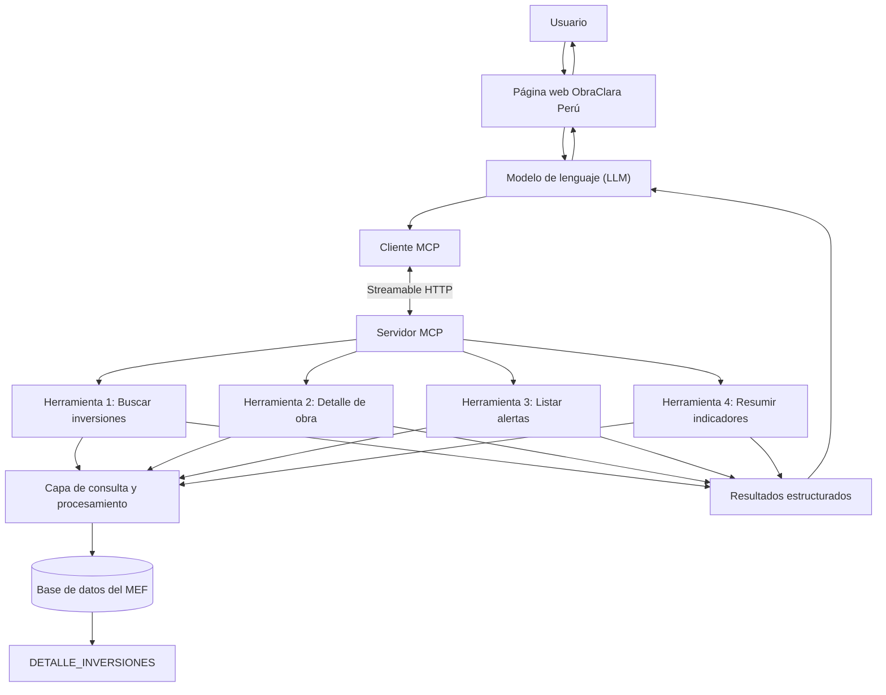

# Material de apoyo: revisión del proyecto hecha con ChatGPT (18/11/2026)

> **Hecho con IA (ChatGPT), no es parte del informe.** Se guarda como referencia para que el grupo redacte y **vuelva a dibujar a mano** los diagramas y gráficos del informe (la rúbrica prohíbe IA en la redacción, el workflow y los gráficos del informe). Las cifras de los gráficos de plantilla con ceros no son datos; los datos reales están en `eval/resultados/` y `metricas/resultados/`.

Origen: conversación compartida por un compañero (https://chatgpt.com/share/6afdbd53-d28c-83e9-8d65-dcb7985e7a71). Análisis de qué se aplicó: ver la sección «Revisión externa» en `docs/PROYECTO.md` o el registro privado.

## Diagramas (Mermaid)

## Gráficos propuestos (datos de cada gráfico)

**Comparación de las métricas registradas en el repositorio.** · tipo: bar
| metrica | sin | con |
|---|---|---|
| Exactitud | 8 | 100 |
| Citación | 10 | 100 |
| Información inventada | 53 | 0 |

**Plantilla ilustrativa; completar con los resultados medidos.** · tipo: bar
| sistema | porcentaje |
|---|---|
| Sin MCP | 0 |
| Con MCP | 0 |

**Plantilla ilustrativa; completar con los resultados medidos.** · tipo: bar
| sistema | porcentaje |
|---|---|
| Sin MCP | 0 |
| Con MCP | 0 |

**Plantilla ilustrativa; completar con los resultados medidos.** · tipo: bar
| sistema | porcentaje |
|---|---|
| Sin MCP | 0 |
| Con MCP | 0 |

## Tablas propuestas

| Carpeta | Contenido |
|--------|--------|
| `worker/` | Servidor MCP, consultas, interfaz web y pruebas |
| `etl/` | Procesamiento del CSV del MEF y carga de datos |
| `conector/` | Conexión entre el servidor, la IA y SQLite |
| `eval/` | Banco de 40 preguntas, ejecución y puntuación |
| `docs/capturas/` | Evidencias visuales |
| `.github/workflows/` | Automatización de pruebas y despliegue |

| Indicador | Sin MCP | Con MCP |
|--------|--------|--------|
| Exactitud | 8 % | **100 %** |
| Citación correcta | 10 % | **100 %** |
| Información inventada\* | 53 % | **0 %** |
| Casos por revisar | 20 | 0 |

| Carpeta | Contenido |
|---|---|
| `worker/` | Servidor MCP, consultas, interfaz web y pruebas |
| `etl/` | Procesamiento del CSV del MEF y carga de datos |
| `conector/` | Conexión entre el servidor, la IA y SQLite |
| `eval/` | Banco de 40 preguntas, ejecución y puntuación |
| `docs/capturas/` | Evidencias visuales |
| `.github/workflows/` | Automatización de pruebas y despliegue |

| Sección | Contenido |
|---|---|
| Resumen | Problema, solución, metodología y resultados reales |
| 1. Introducción | Problema, justificación y objetivos |
| 2. Marco teórico | LLM, agentes, MCP, RAG, datos abiertos y ODS 16 |
| 3. Diseño y arquitectura | Diagrama, componentes y flujo del sistema |
| 4. Implementación | Tecnologías, datos y cuatro herramientas MCP |
| 5. Metodología de evaluación | Las 40 preguntas, métricas y condiciones |
| 6. Resultados | Tablas, gráficos y ejemplos comparativos |
| 7. Discusión | Interpretación, ventajas y limitaciones |
| 8. Conclusiones | Hallazgos derivados de las pruebas |
| 9. Referencias | Formato APA 7 |
| Anexo 01 | Documentación técnica |
| Anexo 02 | Coevaluación individual |

| Herramienta | Funcionalidad | Parámetros que deberían documentar |
|--------|--------|--------|
| Buscar inversiones | Localiza inversiones | Región, entidad, sector, CUI |
| Detalle de inversión | Consulta un proyecto específico | CUI |
| Listar alertas | Identifica riesgos | Tipo de alerta, región, entidad |
| Resumir indicadores | Calcula estadísticas | Región, entidad, agrupación |

| Métrica | Sin MCP | Con MCP |
|--------|--------|--------|
| Exactitud | Por medir | Por medir |
| Citación correcta | Por medir | Por medir |
| Información inventada | Por medir | Por medir |

| Criterio | Fuente | Interpretación |
|--------|--------|--------|
| Sobrecosto ≥ 50 % | Datos del MEF | Posible variación elevada del costo |
| Avance físico ≥ 40 % y menor a 100 % | Datos del MEF | Inversión parcialmente ejecutada |
| 6 meses sin devengado | Datos financieros del MEF | Posible inactividad financiera |

| Herramienta | Cantidad de preguntas |
|--------|--------|
| Buscar inversiones | 10 |
| Detalle de inversión | 10 |
| Listar alertas | 10 |
| Resumir indicadores | 10 |
| **Total** | **40** |

| Integrante | Participación | Observaciones |
|--------|--------|--------|
| Adriel Leonel Orihuela Mendoza | Por acordar | Describir aporte real |
| Camila Grace Cárdenas Urteaga | Por acordar | Describir aporte real |
| Piero Alexander Burga Garavito | Por acordar | Describir aporte real |
| Sebastián José Gutiérrez Iparraguirre | Por acordar | Describir aporte real |

| Sección | Contenido |
|--------|--------|
| Resumen | Problema, solución, metodología y resultados reales |
| 1\. Introducción | Problema, justificación y objetivos |
| 2\. Marco teórico | LLM, agentes, MCP, RAG, datos abiertos y ODS 16 |
| 3\. Diseño y arquitectura | Diagrama, componentes y flujo del sistema |
| 4\. Implementación | Tecnologías, datos y cuatro herramientas MCP |
| 5\. Metodología de evaluación | Las 40 preguntas, métricas y condiciones |
| 6\. Resultados | Tablas, gráficos y ejemplos comparativos |
| 7\. Discusión | Interpretación, ventajas y limitaciones |
| 8\. Conclusiones | Hallazgos derivados de las pruebas |
| 9\. Referencias | Formato APA 7 |
| Anexo 01 | Documentación técnica |
| Anexo 02 | Coevaluación individual |

| Herramienta | Funcionalidad | Parámetros que deberían documentar |
|---|---|---|
| Buscar inversiones | Localiza inversiones | Región, entidad, sector, CUI |
| Detalle de inversión | Consulta un proyecto específico | CUI |
| Listar alertas | Identifica riesgos | Tipo de alerta, región, entidad |
| Resumir indicadores | Calcula estadísticas | Región, entidad, agrupación |

| Métrica | Sin MCP | Con MCP |
|---|---:|---:|
| Exactitud | Por medir | Por medir |
| Citación correcta | Por medir | Por medir |
| Información inventada | Por medir | Por medir |

| Criterio | Fuente | Interpretación |
|---|---|---|
| Sobrecosto ≥ 50 % | Datos del MEF | Posible variación elevada del costo |
| Avance físico ≥ 40 % y menor a 100 % | Datos del MEF | Inversión parcialmente ejecutada |
| 6 meses sin devengado | Datos financieros del MEF | Posible inactividad financiera |

| Herramienta | Cantidad de preguntas |
|---|---:|
| Buscar inversiones | 10 |
| Detalle de inversión | 10 |
| Listar alertas | 10 |
| Resumir indicadores | 10 |
| **Total** | **40** |

| Integrante | Participación | Observaciones |
|---|---:|---|
| Adriel Leonel Orihuela Mendoza | Por acordar | Describir aporte real |
| Camila Grace Cárdenas Urteaga | Por acordar | Describir aporte real |
| Piero Alexander Burga Garavito | Por acordar | Describir aporte real |
| Sebastián José Gutiérrez Iparraguirre | Por acordar | Describir aporte real |

| Característica | Información |
|--------|--------|
| Fuente | MEF |
| Archivo | DETALLE\_INVERSIONES |
| Registros | Más de 150 000 inversiones activas |
| Columnas | 68 |
| Tamaño aproximado | 250 MB |
| Identificador | Código Único de Inversiones (CUI) |
| Licencia | Open Data Commons Attribution |

| Métrica | Qué evalúa |
|--------|--------|
| Exactitud | Coincidencia de cifras con los datos oficiales, con tolerancia de ±1 %. |
| Citación correcta | Que la respuesta incluya una fuente y enlace verificables. |
| Información inventada | Frecuencia con la que se presentan datos ausentes en la fuente. |

| Elemento | Situación en el documento |
|--------|--------|
| Nombre y objetivo del proyecto | Definidos |
| Fuente de datos del MEF | Identificada |
| Arquitectura conceptual MCP | Definida |
| Cuatro herramientas | Especificadas |
| Criterios de alerta | Definidos |
| Metodología de evaluación | Definida |
| Código del servidor | No incluido |
| Conexión funcional con los datos | No demostrada en el documento |
| Publicación del servidor | No demostrada |
| Resultados de las 40 preguntas | Pendientes de presentar |

| Característica | Información |
|---|---|
| Fuente | MEF |
| Archivo | DETALLE_INVERSIONES |
| Registros | Más de 150 000 inversiones activas |
| Columnas | 68 |
| Tamaño aproximado | 250 MB |
| Identificador | Código Único de Inversiones (CUI) |
| Licencia | Open Data Commons Attribution |

| Métrica | Qué evalúa |
|---|---|
| Exactitud | Coincidencia de cifras con los datos oficiales, con tolerancia de ±1 %. |
| Citación correcta | Que la respuesta incluya una fuente y enlace verificables. |
| Información inventada | Frecuencia con la que se presentan datos ausentes en la fuente. |

| Elemento | Situación en el documento |
|---|---|
| Nombre y objetivo del proyecto | Definidos |
| Fuente de datos del MEF | Identificada |
| Arquitectura conceptual MCP | Definida |
| Cuatro herramientas | Especificadas |
| Criterios de alerta | Definidos |
| Metodología de evaluación | Definida |
| Código del servidor | No incluido |
| Conexión funcional con los datos | No demostrada en el documento |
| Publicación del servidor | No demostrada |
| Resultados de las 40 preguntas | Pendientes de presentar |

## Conversación completa (bloques sin repetir)

### Bloque 1

# 2. Un hallazgo importante: ya tienen resultados experimentales

He encontrado algo especialmente útil: el archivo `eval/resultados/resumen.md` contiene los resultados de las 40 preguntas.

<badge color="success">40 de 40 ejecutadas en ambos escenarios</badge>

Estos son los resultados publicados en el repositorio:

<box border radius="lg" padding={3} gap={3}>
  **Comparación experimental**
  <text color="secondary" size="xs">Evaluación registrada el 18 de noviembre de 2026.</text>
  | Indicador | Sin MCP | Con MCP |
  |---|---:|---:|
  | Exactitud | 8 % | **100 %** |
  | Citación correcta | 10 % | **100 %** |
  | Información inventada* | 53 % | **0 %** |
  | Casos por revisar | 20 | 0 |
  <divider color="subtle"/>
  **Latencia promedio total**
  <grid columns={2} gap={2}>
    <grid-item>
      <title size="2xl" tabularNums>22.1 s</title>
      <text color="secondary" size="xs">Sin MCP</text>
    </grid-item>
    <grid-item>
      <title size="2xl" tabularNums>99.9 s</title>
      <text color="secondary" size="xs">Con MCP</text>
    </grid-item>
  </grid>
  <caption>*El propio informe advierte que esta métrica puede clasificar como inventadas respuestas que utilizan otras fuentes oficiales o fechas diferentes. Fuente: <Link url="https://github.com/adrielorihuela/obraclara-mcp/blob/main/eval/resultados/resumen.md" title="Resultados de evaluación"/>.</caption>
</box>

[gráfico: ver sección «Gráficos propuestos»]

Esto es excelente material para el informe final, pero hay que presentar los resultados con rigor.

## 3. Mejoras adicionales que he detectado al revisar los resultados

Hay tres aspectos que no dejaría pasar:

1. **Revisar manualmente las respuestas.** El puntuador automático considera exacta una respuesta si encuentra al menos un valor coincidente dentro del margen del 1 %. Eso no garantiza que todas las cifras de la respuesta sean correctas.
2. **Revisar los tiempos de respuesta.** Algunas consultas con MCP tardaron más de 400 segundos. Conviene investigar los reintentos y mejorar la latencia.
3. **Verificar las operaciones aritméticas.** En la respuesta D04 del archivo de resultados hay una diferencia entre el incremento declarado y la resta del costo actualizado menos el monto viable. Es un ejemplo concreto de por qué necesitamos una revisión manual. <Cite refs={["turn415191view0","turn501314view0"]}/>

También es importante mencionar que se realizó una sola corrida por condición, por lo que todavía no se conoce la variabilidad de los resultados.

# 4. Mi propuesta para continuar

Ya tenemos suficiente información para comenzar a construir el informe final con evidencias reales.

Sugiero empezar por el **capítulo 3: Diseño y arquitectura de ObraClara Perú**, utilizando el código existente para documentar fielmente:

- Arquitectura del sistema.
- Tecnologías utilizadas.
- Flujo de comunicación.
- Procesamiento de los datos oficiales del MEF.
- Funcionamiento de las cuatro herramientas MCP.

Después podremos desarrollar el capítulo de resultados utilizando los archivos CSV y Markdown existentes.

**Mi recomendación es no modificar todavía el código del servidor. Primero documentemos y auditemos lo que ya funciona; luego corregiremos los problemas que encontremos.** Así evitamos introducir errores en una plataforma que ya está publicada.

### Bloque 2

function __dilSafe(evaluate,failureValue){try{return evaluate()}catch{return failureValue}}

DIL.render(__dil.jsx(()=>{const __dilConstants=DIL.useConstants();const __dilModelDataBindings=DIL.useAppData((appData)=>appData.opGenui?.modelDataBindings??{});return __dil.jsx(__dil.Fragment,null,__dil.jsx("text",null,__dilConstants["0"],__dil.jsx("bold",null,__dilConstants["1"]),__dilConstants["2"]),__dil.jsx("text",null,__dilConstants["3"]),__dilSafe(()=>(__dil.jsx(Link,{"url":"https://github.com/adrielorihuela/obraclara-mcp","title":__dilConstants["4"],"__resolutionId":__dilConstants["5"]})),null),__dil.jsx("title",{"size":"lg"},__dilConstants["6"]),__dil.jsx("text",null,__dilConstants["7"]),__dil.jsx("table",null,__dil.jsx("table-row",null,__dil.jsx("table-cell",{"header":true},__dil.jsx("text",null,__dilConstants["8"])),__dil.jsx("table-cell",{"header":true},__dil.jsx("text",null,__dilConstants["9"]))),__dil.jsx("table-row",null,__dil.jsx("table-cell",null,__dil.jsx("text",null,__dil.jsx("code",null,__dilConstants["10"]))),__dil.jsx("table-cell",null,__dil.jsx("text",null,__dilConstants["11"]))),__dil.jsx("table-row",null,__dil.jsx("table-cell",null,__dil.jsx("text",null,__dil.jsx("code",null,__dilConstants["12"]))),__dil.jsx("table-cell",null,__dil.jsx("text",null,__dilConstants["13"]))),__dil.jsx("table-row",null,__dil.jsx("table-cell",null,__dil.jsx("text",null,__dil.jsx("code",null,__dilConstants["14"]))),__dil.jsx("table-cell",null,__dil.jsx("text",null,__dilConstants["15"]))),__dil.jsx("table-row",null,__dil.jsx("table-cell",null,__dil.jsx("text",null,__dil.jsx("code",null,__dilConstants["16"]))),__dil.jsx("table-cell",null,__dil.jsx("text",null,__dilConstants["17"]))),__dil.jsx("table-row",null,__dil.jsx("table-cell",null,__dil.jsx("text",null,__dil.jsx("code",null,__dilConstants["18"]))),__dil.jsx("table-cell",null,__dil.jsx("text",null,__dilConstants["19"]))),__dil.jsx("table-row",null,__dil.jsx("table-cell",null,__dil.jsx("text",null,__dil.jsx("code",null,__dilConstants["20"]))),__dil.jsx("table-cell",null,__dil.jsx("text",null,__dilConstants["21"])))),__dil.jsx("text",null,__dilConstants["22"]),__dil.jsx("list",{"marker":"number"},__dil.jsx("list-item",null,__dil.jsx("text",null,__dil.jsx("code",null,__dilConstants["23"]))),__dil.jsx("list-item",null,__dil.jsx("text",null,__dil.jsx("code",null,__dilConstants["24"]))),__dil.jsx("list-item",null,__dil.jsx("text",null,__dil.jsx("code",null,__dilConstants["25"]))),__dil.jsx("list-item",null,__dil.jsx("text",null,__dil.jsx("code",null,__dilConstants["26"])))),__dil.jsx("text",null,__dilConstants["27"],__dilSafe(()=>(__dil.jsx(Cite,{"refs":__dilConstants["28"],"__resolutionId":__dilConstants["29"]})),null)),__dil.jsx("text",null,__dil.jsx("bold",null,__dilConstants["30"]),__dilConstants["31"]),__dil.jsx("title",{"size":"xl"},__dilConstants["32"]),__dil.jsx("text",null,__dilConstants["33"],__dil.jsx("code",null,__dilConstants["34"]),__dilConstants["35"]),__dil.jsx("badge",{"color":"success"},__dilConstants["36"]),__dil.jsx("text",null,__dilConstants["37"]),__dil.jsx("box",{"border":true,"radius":"lg","padding":3,"gap":3},__dil.jsx("text",null,__dil.jsx("bold",null,__dilConstants["38"])),__dil.jsx("text",{"color":"secondary","size":"xs"},__dilConstants["39"]),__dil.jsx("table",null,__dil.jsx("table-row",null,__dil.jsx("table-cell",{"header":true},__dil.jsx("text",null,__dilConstants["40"])),__dil.jsx("table-cell",{"header":true,"align":"end"},__dil.jsx("text",null,__dilConstants["41"])),__dil.jsx("table-cell",{"header":true,"align":"end"},__dil.jsx("text",null,__dilConstants["42"]))),__dil.jsx("table-row",null,__dil.jsx("table-cell",null,__dil.jsx("text",null,__dilConstants["43"])),__dil.jsx("table-cell",{"align":"end"},__dil.jsx("text",null,__dilConstants["44"])),__dil.jsx("table-cell",{"align":"end"},__dil.jsx("text",null,__dil.jsx("bold",null,__dilConstants["45"])))),__dil.jsx("table-row",null,__dil.jsx("table-cell",null,__dil.jsx("text",null,__dilConstants["46"])),__dil.jsx("table-cell",{"align":"end"},__dil.jsx("text",null,__dilConstants["47"])),__dil.jsx("table-cell",{"align":"end"},__dil.jsx("text",null,__dil.jsx("bold",null,__dilConstants["48"])))),__dil.jsx("table-row",null,__dil.jsx("table-cell",null,__dil.jsx("text",null,__dilConstants["49"])),__dil.jsx("table-cell",{"align":"end"},__dil.jsx("text",null,__dilConstants["50"])),__dil.jsx("table-cell",{"align":"end"},__dil.jsx("text",null,__dil.jsx("bold",null,__dilConstants["51"])))),__dil.jsx("table-row",null,__dil.jsx("table-cell",null,__dil.jsx("text",null,__dilConstants["52"])),__dil.jsx("table-cell",{"align":"end"},__dil.jsx("text",null,__dilConstants["53"])),__dil.jsx("table-cell",{"align":"end"},__dil.jsx("text",null,__dilConstants["54"])))),__dil.jsx("divider",{"color":"subtle"}),__dil.jsx("text",null,__dil.jsx("bold",null,__dilConstants["55"])),__dil.jsx("grid",{"columns":2,"gap":2},__dil.jsx("grid-item",null,__dil.jsx("title",{"size":"2xl","tabularNums":true},__dilConstants["56"]),__dil.jsx("text",{"color":"secondary","size":"xs"},__dilConstants["57"])),__dil.jsx("grid-item",null,__dil.jsx("title",{"size":"2xl","tabularNums":true},__dilConstants["58"]),__dil.jsx("text",{"color":"secondary","size":"xs"},__dilConstants["59"]))),__dil.jsx("caption",null,__dilConstants["60"],__dilSafe(()=>(__dil.jsx(Link,{"url":"https://github.com/adrielorihuela/obraclara-mcp/blob/main/eval/resultados/resumen.md","title":__dilConstants["61"],"__resolutionId":__dilConstants["62"]})),null),__dilConstants["63"])),(__dilConstants["65"]==null?__dil.jsx("__chatgptClientDefinedWidget",{"key":"cdw:0","invocationId":__dilConstants["64"]}):__dilConstants["65"].type==="math"?__dil.jsx("math",{"key":"cdw:0","value":__dilConstants["65"].value}):__dilConstants["65"].type==="text"?__dil.jsx("text",{"key":"cdw:0"},__dilConstants["65"].value):null),__dil.jsx("text",null,__dilConstants["66"]),__dil.jsx("title",{"size":"lg"},__dilConstants["67"]),__dil.jsx("text",null,__dilConstants["68"]),__dil.jsx("list",{"marker":"number"},__dil.jsx("list-item",null,__dil.jsx("text",null,__dil.jsx("bold",null,__dilConstants["69"]),__dilConstants["70"])),__dil.jsx("list-item",null,__dil.jsx("text",null,__dil.jsx("bold",null,__dilConstants["71"]),__dilConstants["72"])),__dil.jsx("list-item",null,__dil.jsx("text",null,__dil.jsx("bold",null,__dilConstants["73"]),__dilConstants["74"],__dilSafe(()=>(__dil.jsx(Cite,{"refs":__dilConstants["75"],"__resolutionId":__dilConstants["76"]})),null)))),__dil.jsx("text",null,__dilConstants["77"]),__dil.jsx("title",{"size":"xl"},__dilConstants["78"]),__dil.jsx("text",null,__dilConstants["79"]),__dil.jsx("text",null,__dilConstants["80"],__dil.jsx("bold",null,__dilConstants["81"]),__dilConstants["82"]),__dil.jsx("list",{"marker":"bullet"},__dil.jsx("list-item",null,__dil.jsx("text",null,__dilConstants["83"])),__dil.jsx("list-item",null,__dil.jsx("text",null,__dilConstants["84"])),__dil.jsx("list-item",null,__dil.jsx("text",null,__dilConstants["85"])),__dil.jsx("list-item",null,__dil.jsx("text",null,__dilConstants["86"])),__dil.jsx("list-item",null,__dil.jsx("text",null,__dilConstants["87"]))),__dil.jsx("text",null,__dilConstants["88"]),__dil.jsx("text",null,__dil.jsx("bold",null,__dilConstants["89"]),__dilConstants["90"]));},{"key":"body:0"}));

### Bloque 3

genui{"charts_widget_v2":{"content":{"chartType":"bar","meta":{"description":"Comparaci\u00f3n de las m\u00e9tricas registradas en el repositorio."},"xKey":"metrica","series":[{"dataKey":"sin","label":"Sin MCP","stack":"a","valueSuffix":"%"},{"dataKey":"con","label":"Con MCP","stack":"b","valueSuffix":"%"}],"yAxisMin":0,"yAxisMax":100,"data":[{"metrica":"Exactitud","sin":8,"con":100},{"metrica":"Citaci\u00f3n","sin":10,"con":100},{"metrica":"Informaci\u00f3n inventada","sin":53,"con":0}]}}}

### Bloque 4

¡Perfecto\! Entonces trabajaremos directamente sobre el repositorio actualizado de **ObraClara Perú**, sin reconstruir el proyecto desde cero.

He comenzado a revisar su contenido y hay buenas noticias: el repositorio ya tiene una estructura bastante completa para responder a las observaciones del profesor.

urlRepositorio oficial de ObraClara Perúhttps://github.com/adrielorihuela/obraclara-mcp

## 1\. Lo que ya tienen implementado según el repositorio

He identificado estas carpetas\:

| Carpeta | Contenido |
|--------|--------|
| `worker/` | Servidor MCP, consultas, interfaz web y pruebas |
| `etl/` | Procesamiento del CSV del MEF y carga de datos |
| `conector/` | Conexión entre el servidor, la IA y SQLite |
| `eval/` | Banco de 40 preguntas, ejecución y puntuación |
| `docs/capturas/` | Evidencias visuales |
| `.github/workflows/` | Automatización de pruebas y despliegue |

También he encontrado documentación de las cuatro herramientas\:

1. `buscar_inversiones`
2. `detalle_inversion`
3. `alertas_inversion`
4. `resumen_inversiones`

El README documenta incluso el procesamiento del CSV, las reglas de alertas, los prompts y las instrucciones para reproducir el proyecto. citeturn956091view0

**Esto es importante\:** varias de las recomendaciones del profesor ya tienen una base técnica dentro del repositorio. Nuestro trabajo será convertir esa implementación en evidencia clara y académicamente bien presentada.

# 2\. Un hallazgo importante: ya tienen resultados experimentales

He encontrado algo especialmente útil: el archivo `eval/resultados/resumen.md` contiene los resultados de las 40 preguntas.

(40 de 40 ejecutadas en ambos escenarios)

Estos son los resultados publicados en el repositorio\:

**Comparación experimental**

Evaluación registrada el 18 de noviembre de 2026.

| Indicador | Sin MCP | Con MCP |
|--------|--------|--------|
| Exactitud | 8 % | **100 %** |
| Citación correcta | 10 % | **100 %** |
| Información inventada\* | 53 % | **0 %** |
| Casos por revisar | 20 | 0 |

---

**Latencia promedio total**

# 22.1 s

Sin MCP

# 99.9 s

Con MCP

\*El propio informe advierte que esta métrica puede clasificar como inventadas respuestas que utilizan otras fuentes oficiales o fechas diferentes. Fuente: urlResultados de evaluaciónhttps://github.com/adrielorihuela/obraclara-mcp/blob/main/eval/resultados/resumen.md\.

genui{"charts_widget_v2":{"content":{"chartType":"bar","meta":{"description":"Comparaci\u00f3n de las m\u00e9tricas registradas en el repositorio."},"xKey":"metrica","series":[{"dataKey":"sin","label":"Sin MCP","stack":"a","valueSuffix":"%"},{"dataKey":"con","label":"Con MCP","stack":"b","valueSuffix":"%"}],"yAxisMin":0,"yAxisMax":100,"data":[{"metrica":"Exactitud","sin":8,"con":100},{"metrica":"Citaci\u00f3n","sin":10,"con":100},{"metrica":"Informaci\u00f3n inventada","sin":53,"con":0}]}}}

Esto es excelente material para el informe final, pero hay que presentar los resultados con rigor.

## 3\. Mejoras adicionales que he detectado al revisar los resultados

Hay tres aspectos que no dejaría pasar\:

1. **Revisar manualmente las respuestas.** El puntuador automático considera exacta una respuesta si encuentra al menos un valor coincidente dentro del margen del 1 %. Eso no garantiza que todas las cifras de la respuesta sean correctas.
2. **Revisar los tiempos de respuesta.** Algunas consultas con MCP tardaron más de 400 segundos. Conviene investigar los reintentos y mejorar la latencia.
3. **Verificar las operaciones aritméticas.** En la respuesta D04 del archivo de resultados hay una diferencia entre el incremento declarado y la resta del costo actualizado menos el monto viable. Es un ejemplo concreto de por qué necesitamos una revisión manual. citeturn415191view0turn501314view0

También es importante mencionar que se realizó una sola corrida por condición, por lo que todavía no se conoce la variabilidad de los resultados.

# 4\. Mi propuesta para continuar

Ya tenemos suficiente información para comenzar a construir el informe final con evidencias reales.

Sugiero empezar por el **capítulo 3: Diseño y arquitectura de ObraClara Perú**, utilizando el código existente para documentar fielmente\:

- Arquitectura del sistema.
- Tecnologías utilizadas.
- Flujo de comunicación.
- Procesamiento de los datos oficiales del MEF.
- Funcionamiento de las cuatro herramientas MCP.

Después podremos desarrollar el capítulo de resultados utilizando los archivos CSV y Markdown existentes.

**Mi recomendación es no modificar todavía el código del servidor. Primero documentemos y auditemos lo que ya funciona; luego corregiremos los problemas que encontremos.** Así evitamos introducir errores en una plataforma que ya está publicada.

---

Si quieres, puedo:

- Expand design documentation with architecture diagram
- Describe methodology and results for 40 test questions
- Guide next steps to finalize the report

### Bloque 5

¡Perfecto! Entonces trabajaremos directamente sobre el repositorio actualizado de **ObraClara Perú**, sin reconstruir el proyecto desde cero.

He comenzado a revisar su contenido y hay buenas noticias: el repositorio ya tiene una estructura bastante completa para responder a las observaciones del profesor.

<Link url="https://github.com/adrielorihuela/obraclara-mcp" title="Repositorio oficial de ObraClara Perú"/>

## 1. Lo que ya tienen implementado según el repositorio

He identificado estas carpetas:

| Carpeta | Contenido |
|---|---|
| `worker/` | Servidor MCP, consultas, interfaz web y pruebas |
| `etl/` | Procesamiento del CSV del MEF y carga de datos |
| `conector/` | Conexión entre el servidor, la IA y SQLite |
| `eval/` | Banco de 40 preguntas, ejecución y puntuación |
| `docs/capturas/` | Evidencias visuales |
| `.github/workflows/` | Automatización de pruebas y despliegue |

También he encontrado documentación de las cuatro herramientas:

1. `buscar_inversiones`
2. `detalle_inversion`
3. `alertas_inversion`
4. `resumen_inversiones`

El README documenta incluso el procesamiento del CSV, las reglas de alertas, los prompts y las instrucciones para reproducir el proyecto. <Cite refs={["turn956091view0"]}/>

**Esto es importante:** varias de las recomendaciones del profesor ya tienen una base técnica dentro del repositorio. Nuestro trabajo será convertir esa implementación en evidencia clara y académicamente bien presentada.

# 2. Un hallazgo importante: ya tienen resultados experimentales

He encontrado algo especialmente útil: el archivo `eval/resultados/resumen.md` contiene los resultados de las 40 preguntas.

<badge color="success">40 de 40 ejecutadas en ambos escenarios</badge>

Estos son los resultados publicados en el repositorio:

<box border radius="lg" padding={3} gap={3}>
  **Comparación experimental**
  <text color="secondary" size="xs">Evaluación registrada el 18 de noviembre de 2026.</text>
  | Indicador | Sin MCP | Con MCP |
  |---|---:|---:|
  | Exactitud | 8 % | **100 %** |
  | Citación correcta | 10 % | **100 %** |
  | Información inventada* | 53 % | **0 %** |
  | Casos por revisar | 20 | 0 |
  <divider color="subtle"/>
  **Latencia promedio total**
  <grid columns={2} gap={2}>
    <grid-item>
      <title size="2xl" tabularNums>22.1 s</title>
      <text color="secondary" size="xs">Sin MCP</text>
    </grid-item>
    <grid-item>
      <title size="2xl" tabularNums>99.9 s</title>
      <text color="secondary" size="xs">Con MCP</text>
    </grid-item>
  </grid>
  <caption>*El propio informe advierte que esta métrica puede clasificar como inventadas respuestas que utilizan otras fuentes oficiales o fechas diferentes. Fuente: <Link url="https://github.com/adrielorihuela/obraclara-mcp/blob/main/eval/resultados/resumen.md" title="Resultados de evaluación"/>.</caption>
</box>

[gráfico: ver sección «Gráficos propuestos»]

Esto es excelente material para el informe final, pero hay que presentar los resultados con rigor.

## 3. Mejoras adicionales que he detectado al revisar los resultados

Hay tres aspectos que no dejaría pasar:

1. **Revisar manualmente las respuestas.** El puntuador automático considera exacta una respuesta si encuentra al menos un valor coincidente dentro del margen del 1 %. Eso no garantiza que todas las cifras de la respuesta sean correctas.
2. **Revisar los tiempos de respuesta.** Algunas consultas con MCP tardaron más de 400 segundos. Conviene investigar los reintentos y mejorar la latencia.
3. **Verificar las operaciones aritméticas.** En la respuesta D04 del archivo de resultados hay una diferencia entre el incremento declarado y la resta del costo actualizado menos el monto viable. Es un ejemplo concreto de por qué necesitamos una revisión manual. <Cite refs={["turn415191view0","turn501314view0"]}/>

También es importante mencionar que se realizó una sola corrida por condición, por lo que todavía no se conoce la variabilidad de los resultados.

# 4. Mi propuesta para continuar

Ya tenemos suficiente información para comenzar a construir el informe final con evidencias reales.

Sugiero empezar por el **capítulo 3: Diseño y arquitectura de ObraClara Perú**, utilizando el código existente para documentar fielmente:

- Arquitectura del sistema.
- Tecnologías utilizadas.
- Flujo de comunicación.
- Procesamiento de los datos oficiales del MEF.
- Funcionamiento de las cuatro herramientas MCP.

Después podremos desarrollar el capítulo de resultados utilizando los archivos CSV y Markdown existentes.

**Mi recomendación es no modificar todavía el código del servidor. Primero documentemos y auditemos lo que ya funciona; luego corregiremos los problemas que encontremos.** Así evitamos introducir errores en una plataforma que ya está publicada.

---

Si quieres, puedo:

- Expand design documentation with architecture diagram
- Describe methodology and results for 40 test questions
- Guide next steps to finalize the report

### Bloque 6

# 3. Estructura que recomiendo para el informe final

Para que el documento tenga una secuencia lógica y responda a todas las observaciones del profesor, recomiendo esta estructura:

| Sección | Contenido |
|---|---|
| Resumen | Problema, solución, metodología y resultados reales |
| 1. Introducción | Problema, justificación y objetivos |
| 2. Marco teórico | LLM, agentes, MCP, RAG, datos abiertos y ODS 16 |
| 3. Diseño y arquitectura | Diagrama, componentes y flujo del sistema |
| 4. Implementación | Tecnologías, datos y cuatro herramientas MCP |
| 5. Metodología de evaluación | Las 40 preguntas, métricas y condiciones |
| 6. Resultados | Tablas, gráficos y ejemplos comparativos |
| 7. Discusión | Interpretación, ventajas y limitaciones |
| 8. Conclusiones | Hallazgos derivados de las pruebas |
| 9. Referencias | Formato APA 7 |
| Anexo 01 | Documentación técnica |
| Anexo 02 | Coevaluación individual |

# 4. ¿Qué deberíamos hacer primero?

No recomiendo empezar modificando la redacción del PDF. Primero debemos comprobar y documentar correctamente el funcionamiento del sistema.

Este sería nuestro orden de trabajo:

<box border radius="lg" padding={3} gap={3}>
  <title size="lg">Plan de trabajo para la entrega final</title>
  <list connector="solid" marker="number" gap={3}>
    <list-item>
      **Revisar el código existente**

      Comprobar el servidor MCP, sus cuatro herramientas y la conexión con el MEF.
      <badge color="success">Primero</badge>
    </list-item>
    <list-item>
      **Documentar la arquitectura**

      Crear el diagrama y explicar el funcionamiento técnico.
    </list-item>
    <list-item>
      **Verificar las alertas**

      Revisar los cálculos de sobrecostos y posibles paralizaciones.
    </list-item>
    <list-item>
      **Ejecutar las 40 preguntas**

      Guardar respuestas, fuentes y evidencias de ambos escenarios.
    </list-item>
    <list-item>
      **Analizar los resultados**

      Calcular métricas, generar gráficos y comparar.
    </list-item>
    <list-item>
      **Redactar el informe final**

      Incorporar resultados, discusión, conclusiones y anexos.
    </list-item>
  </list>
</box>

# 5. Quiero comenzar revisando el proyecto técnicamente

Como ya tienen una página web publicada y un repositorio, sería un error reconstruir el servidor sin antes revisar lo que ya funciona.

Te propongo comenzar por el repositorio:

<Link url="https://github.com/adrielorihuela/obraclara-mcp" title="Repositorio de ObraClara Perú en GitHub"/>

**Una pregunta para organizar nuestro trabajo:**

¿El repositorio de GitHub contiene la versión más reciente del servidor MCP que actualmente está conectado a la página web?

{@body const [choice,setChoice] = DIL.useState("yes")}
{@body const [other,setOther] = DIL.useState("")}
<box border radius="lg" padding={3} gap={3}>
  <radio-group direction="col" value={choice} onChange={setChoice}>
    <radio value="yes">Sí, contiene todo el código actualizado.</radio>
    <radio value="partial">Contiene parte del código, pero faltan archivos.</radio>
    <radio value="no">No, el código más reciente está en mi computadora.</radio>
    <radio value="unknown">No estoy seguro.</radio>
  </radio-group>
  {#if choice==="no"}
    <textarea value={other} onChange={setOther} placeholder="¿En qué carpeta o entorno tienen el proyecto?" rows={2}/>
  {/if}
  <button block onClick={()=>GenUI.issueNewTurn("Sobre el repositorio de ObraClara Perú: "+({yes:"Sí, contiene todo el código actualizado.",partial:"Contiene parte del código, pero faltan archivos.",no:"No, el código más reciente está en mi computadora. "+other,unknown:"No estoy seguro."}[choice]))}>Continuar</button>
</box>

Mi objetivo es ayudarte a que la entrega final no solo esté bien redactada, sino que tenga evidencia técnica y resultados suficientes para defender ObraClara Perú ante el profesor.

### Bloque 7

genui{"charts_widget_v2":{"content":{"chartType":"bar","meta":{"description":"Plantilla ilustrativa; completar con los resultados medidos."},"xKey":"sistema","series":[{"dataKey":"porcentaje","label":"Respuestas con informaci\u00f3n inventada","valueSuffix":"%"}],"yAxisMin":0,"yAxisMax":100,"data":[{"sistema":"Sin MCP","porcentaje":0},{"sistema":"Con MCP","porcentaje":0}]}}}

### Bloque 8

genui{"charts_widget_v2":{"content":{"chartType":"bar","meta":{"description":"Plantilla ilustrativa; completar con los resultados medidos."},"xKey":"sistema","series":[{"dataKey":"porcentaje","label":"Citaci\u00f3n correcta","valueSuffix":"%"}],"yAxisMin":0,"yAxisMax":100,"data":[{"sistema":"Sin MCP","porcentaje":0},{"sistema":"Con MCP","porcentaje":0}]}}}

### Bloque 9

genui{"charts_widget_v2":{"content":{"chartType":"bar","meta":{"description":"Plantilla ilustrativa; completar con los resultados medidos."},"xKey":"sistema","series":[{"dataKey":"porcentaje","label":"Exactitud","valueSuffix":"%"}],"yAxisMin":0,"yAxisMax":100,"data":[{"sistema":"Sin MCP","porcentaje":0},{"sistema":"Con MCP","porcentaje":0}]}}}

### Bloque 10

### Bloque 11

flowchart TD
    U["Usuario"] --> W["Página web ObraClara Perú"]
    W --> L["Modelo de lenguaje (LLM)"]
    L --> C["Cliente MCP"]
    C <-->|"Streamable HTTP"| M["Servidor MCP"]

    M --> H1["Herramienta 1: Buscar inversiones"]
    M --> H2["Herramienta 2: Detalle de obra"]
    M --> H3["Herramienta 3: Listar alertas"]
    M --> H4["Herramienta 4: Resumir indicadores"]

    H1 --> D["Capa de consulta y procesamiento"]
    H2 --> D
    H3 --> D
    H4 --> D

    D --> DB[("Base de datos del MEF")]
    DB --> CSV["DETALLE_INVERSIONES"]

    H1 --> R["Resultados estructurados"]
    H2 --> R
    H3 --> R
    H4 --> R
    R --> L
    L --> W
    W --> U

### Bloque 12

function __dilSafe(evaluate,failureValue){try{return evaluate()}catch{return failureValue}}

DIL.render(__dil.jsx(()=>{const __dilConstants=DIL.useConstants();const __dilModelDataBindings=DIL.useAppData((appData)=>appData.opGenui?.modelDataBindings??{});const [choice,setChoice] = DIL.useState("yes",{key:"choice"})
const [other,setOther] = DIL.useState("",{key:"other"})
return __dil.jsx(__dil.Fragment,null,__dil.jsx("text",null,__dilConstants["0"],__dil.jsx("bold",null,__dilConstants["1"]),__dilConstants["2"]),__dil.jsx("text",null,__dilConstants["3"],__dil.jsx("bold",null,__dilConstants["4"]),__dilConstants["5"]),__dil.jsx("text",null,__dilConstants["6"]),__dil.jsx("title",{"size":"xl"},__dilConstants["7"]),__dil.jsx("text",null,__dil.jsx("badge",{"color":"success"},__dilConstants["8"]),__dilConstants["9"]),__dil.jsx("box",{"border":true,"radius":"lg","gap":3,"padding":3},__dil.jsx("text",null,__dil.jsx("bold",null,__dilConstants["10"])),__dilSafe(()=>(([{n:"Introducción y planteamiento del problema",s:"Bien desarrollado",v:90},{n:"Marco teórico y referencias",s:"Bien desarrollado",v:85},{n:"Fuente oficial de datos",s:"Identificada",v:85},{n:"Criterios de alertas",s:"Requiere mayor justificación",v:60},{n:"Arquitectura técnica",s:"Falta documentación visual",v:35},{n:"Implementación y tecnologías",s:"Falta profundizar",v:35},{n:"Resultados experimentales",s:"Falta presentar evidencias",v:10},{n:"Conclusiones",s:"Pendientes",v:10}]).map((item)=>__dilSafe(()=>(__dil.jsx("box",{"gap":1},__dil.jsx("row",{"align":"center","justify":"between"},__dilSafe(()=>(__dil.jsx("text",{"weight":"medium","size":"sm"},item.n)),null),__dilSafe(()=>(__dil.jsx("text",{"color":"secondary","size":"xs"},item.s)),null)),__dil.jsx("box",{"background":"surface-tertiary","height":"7px","radius":"full","clip":true},__dilSafe(()=>(__dil.jsx("box",{"background":item.v>=80?"#16A36A":item.v>=50?"#D69B36":"#D97757","height":"7px","radius":"full","width":`${item.v}%`})),null)))),null))),[]),__dil.jsx("caption",null,__dilConstants["11"])),__dil.jsx("text",null,__dilConstants["12"]),__dil.jsx("title",{"size":"xl"},__dilConstants["13"]),__dil.jsx("title",{"size":"lg"},__dilConstants["14"]),__dil.jsx("badge",{"color":"danger"},__dilConstants["15"]),__dil.jsx("text",null,__dilConstants["16"]),__dil.jsx("text",null,__dilConstants["17"]),__dil.jsx("text",null,__dilConstants["18"]),(__dilConstants["20"]==null?__dil.jsx("__chatgptClientDefinedWidget",{"key":"cdw:0","invocationId":__dilConstants["19"]}):__dilConstants["20"].type==="math"?__dil.jsx("math",{"key":"cdw:0","value":__dilConstants["20"].value}):__dilConstants["20"].type==="text"?__dil.jsx("text",{"key":"cdw:0"},__dilConstants["20"].value):null),__dil.jsx("text",null,__dilConstants["21"]),__dil.jsx("text",null,__dilConstants["22"]),__dil.jsx("list",{"marker":"bullet"},__dil.jsx("list-item",null,__dil.jsx("text",null,__dilConstants["23"])),__dil.jsx("list-item",null,__dil.jsx("text",null,__dilConstants["24"])),__dil.jsx("list-item",null,__dil.jsx("text",null,__dilConstants["25"])),__dil.jsx("list-item",null,__dil.jsx("text",null,__dilConstants["26"])),__dil.jsx("list-item",null,__dil.jsx("text",null,__dilConstants["27"])),__dil.jsx("list-item",null,__dil.jsx("text",null,__dilConstants["28"]))),__dil.jsx("title",{"size":"lg"},__dilConstants["29"]),__dil.jsx("badge",{"color":"danger"},__dilConstants["30"]),__dil.jsx("text",null,__dilConstants["31"]),__dil.jsx("text",null,__dilConstants["32"]),__dil.jsx("text",null,__dil.jsx("bold",null,__dilConstants["33"])),__dil.jsx("text",null,__dilConstants["34"]),__dil.jsx("table",null,__dil.jsx("table-row",null,__dil.jsx("table-cell",{"header":true},__dil.jsx("text",null,__dilConstants["35"])),__dil.jsx("table-cell",{"header":true},__dil.jsx("text",null,__dilConstants["36"])),__dil.jsx("table-cell",{"header":true},__dil.jsx("text",null,__dilConstants["37"]))),__dil.jsx("table-row",null,__dil.jsx("table-cell",null,__dil.jsx("text",null,__dilConstants["38"])),__dil.jsx("table-cell",null,__dil.jsx("text",null,__dilConstants["39"])),__dil.jsx("table-cell",null,__dil.jsx("text",null,__dilConstants["40"]))),__dil.jsx("table-row",null,__dil.jsx("table-cell",null,__dil.jsx("text",null,__dilConstants["41"])),__dil.jsx("table-cell",null,__dil.jsx("text",null,__dilConstants["42"])),__dil.jsx("table-cell",null,__dil.jsx("text",null,__dilConstants["43"]))),__dil.jsx("table-row",null,__dil.jsx("table-cell",null,__dil.jsx("text",null,__dilConstants["44"])),__dil.jsx("table-cell",null,__dil.jsx("text",null,__dilConstants["45"])),__dil.jsx("table-cell",null,__dil.jsx("text",null,__dilConstants["46"]))),__dil.jsx("table-row",null,__dil.jsx("table-cell",null,__dil.jsx("text",null,__dilConstants["47"])),__dil.jsx("table-cell",null,__dil.jsx("text",null,__dilConstants["48"])),__dil.jsx("table-cell",null,__dil.jsx("text",null,__dilConstants["49"])))),__dil.jsx("text",null,__dilConstants["50"]),__dil.jsx("list",{"marker":"number"},__dil.jsx("list-item",null,__dil.jsx("text",null,__dilConstants["51"])),__dil.jsx("list-item",null,__dil.jsx("text",null,__dilConstants["52"])),__dil.jsx("list-item",null,__dil.jsx("text",null,__dilConstants["53"])),__dil.jsx("list-item",null,__dil.jsx("text",null,__dilConstants["54"])),__dil.jsx("list-item",null,__dil.jsx("text",null,__dilConstants["55"])),__dil.jsx("list-item",null,__dil.jsx("text",null,__dilConstants["56"])),__dil.jsx("list-item",null,__dil.jsx("text",null,__dilConstants["57"])),__dil.jsx("list-item",null,__dil.jsx("text",null,__dilConstants["58"]))),__dil.jsx("text",null,__dilConstants["59"]),__dil.jsx("list",{"marker":"bullet"},__dil.jsx("list-item",null,__dil.jsx("text",null,__dilConstants["60"])),__dil.jsx("list-item",null,__dil.jsx("text",null,__dilConstants["61"])),__dil.jsx("list-item",null,__dil.jsx("text",null,__dilConstants["62"])),__dil.jsx("list-item",null,__dil.jsx("text",null,__dilConstants["63"])),__dil.jsx("list-item",null,__dil.jsx("text",null,__dilConstants["64"])),__dil.jsx("list-item",null,__dil.jsx("text",null,__dilConstants["65"])),__dil.jsx("list-item",null,__dil.jsx("text",null,__dilConstants["66"]))),__dil.jsx("text",null,__dilConstants["67"]),__dil.jsx("title",{"size":"lg"},__dilConstants["68"]),__dil.jsx("badge",{"color":"danger"},__dilConstants["69"]),__dil.jsx("text",null,__dilConstants["70"]),__dil.jsx("text",null,__dilConstants["71"]),__dil.jsx("list",{"marker":"bullet"},__dil.jsx("list-item",null,__dil.jsx("text",null,__dilConstants["72"])),__dil.jsx("list-item",null,__dil.jsx("text",null,__dilConstants["73"]))),__dil.jsx("text",null,__dilConstants["74"]),__dil.jsx("text",null,__dilConstants["75"]),__dil.jsx("table",null,__dil.jsx("table-row",null,__dil.jsx("table-cell",{"header":true},__dil.jsx("text",null,__dilConstants["76"])),__dil.jsx("table-cell",{"header":true,"align":"end"},__dil.jsx("text",null,__dilConstants["77"])),__dil.jsx("table-cell",{"header":true,"align":"end"},__dil.jsx("text",null,__dilConstants["78"]))),__dil.jsx("table-row",null,__dil.jsx("table-cell",null,__dil.jsx("text",null,__dilConstants["79"])),__dil.jsx("table-cell",{"align":"end"},__dil.jsx("text",null,__dilConstants["80"])),__dil.jsx("table-cell",{"align":"end"},__dil.jsx("text",null,__dilConstants["81"]))),__dil.jsx("table-row",null,__dil.jsx("table-cell",null,__dil.jsx("text",null,__dilConstants["82"])),__dil.jsx("table-cell",{"align":"end"},__dil.jsx("text",null,__dilConstants["83"])),__dil.jsx("table-cell",{"align":"end"},__dil.jsx("text",null,__dilConstants["84"]))),__dil.jsx("table-row",null,__dil.jsx("table-cell",null,__dil.jsx("text",null,__dilConstants["85"])),__dil.jsx("table-cell",{"align":"end"},__dil.jsx("text",null,__dilConstants["86"])),__dil.jsx("table-cell",{"align":"end"},__dil.jsx("text",null,__dilConstants["87"])))),__dil.jsx("text",null,__dilConstants["88"]),__dil.jsx("text",null,__dil.jsx("bold",null,__dilConstants["89"])),__dil.jsx("box",{"border":true,"radius":"lg","padding":3,"gap":2},__dil.jsx("text",null,__dil.jsx("bold",null,__dilConstants["90"])),(__dilConstants["92"]==null?__dil.jsx("__chatgptClientDefinedWidget",{"key":"cdw:1","invocationId":__dilConstants["91"]}):__dilConstants["92"].type==="math"?__dil.jsx("math",{"key":"cdw:1","value":__dilConstants["92"].value}):__dilConstants["92"].type==="text"?__dil.jsx("text",{"key":"cdw:1"},__dilConstants["92"].value):null),__dil.jsx("caption",null,__dilConstants["93"])),__dil.jsx("box",{"border":true,"radius":"lg","padding":3,"gap":2},__dil.jsx("text",null,__dil.jsx("bold",null,__dilConstants["94"])),(__dilConstants["96"]==null?__dil.jsx("__chatgptClientDefinedWidget",{"key":"cdw:2","invocationId":__dilConstants["95"]}):__dilConstants["96"].type==="math"?__dil.jsx("math",{"key":"cdw:2","value":__dilConstants["96"].value}):__dilConstants["96"].type==="text"?__dil.jsx("text",{"key":"cdw:2"},__dilConstants["96"].value):null)),__dil.jsx("box",{"border":true,"radius":"lg","padding":3,"gap":2},__dil.jsx("text",null,__dil.jsx("bold",null,__dilConstants["97"])),(__dilConstants["99"]==null?__dil.jsx("__chatgptClientDefinedWidget",{"key":"cdw:3","invocationId":__dilConstants["98"]}):__dilConstants["99"].type==="math"?__dil.jsx("math",{"key":"cdw:3","value":__dilConstants["99"].value}):__dilConstants["99"].type==="text"?__dil.jsx("text",{"key":"cdw:3"},__dilConstants["99"].value):null)),__dil.jsx("text",null,__dilConstants["100"]),__dil.jsx("list",{"marker":"bullet"},__dil.jsx("list-item",null,__dil.jsx("text",null,__dilConstants["101"])),__dil.jsx("list-item",null,__dil.jsx("text",null,__dilConstants["102"])),__dil.jsx("list-item",null,__dil.jsx("text",null,__dilConstants["103"]))),__dil.jsx("text",null,__dilConstants["104"]),__dil.jsx("title",{"size":"lg"},__dilConstants["105"]),__dil.jsx("badge",{"color":"warning"},__dilConstants["106"]),__dil.jsx("text",null,__dilConstants["107"]),__dil.jsx("text",null,__dilConstants["108"]),__dil.jsx("text",null,__dil.jsx("bold",null,__dilConstants["109"])),__dil.jsx("text",null,__dilConstants["110"]),__dil.jsx("text",null,__dilConstants["111"]),__dil.jsx("list",{"marker":"bullet"},__dil.jsx("list-item",null,__dil.jsx("text",null,__dilConstants["112"])),__dil.jsx("list-item",null,__dil.jsx("text",null,__dilConstants["113"])),__dil.jsx("list-item",null,__dil.jsx("text",null,__dilConstants["114"])),__dil.jsx("list-item",null,__dil.jsx("text",null,__dilConstants["115"])),__dil.jsx("list-item",null,__dil.jsx("text",null,__dilConstants["116"]))),__dil.jsx("text",null,__dil.jsx("bold",null,__dilConstants["117"])),__dil.jsx("text",null,__dilConstants["118"]),__dil.jsx("text",null,__dilConstants["119"]),__dil.jsx("text",null,__dilConstants["120"]),__dil.jsx("list",{"marker":"bullet"},__dil.jsx("list-item",null,__dil.jsx("text",null,__dilConstants["121"])),__dil.jsx("list-item",null,__dil.jsx("text",null,__dilConstants["122"])),__dil.jsx("list-item",null,__dil.jsx("text",null,__dilConstants["123"]))),__dil.jsx("text",null,__dilConstants["124"]),__dil.jsx("table",null,__dil.jsx("table-row",null,__dil.jsx("table-cell",{"header":true},__dil.jsx("text",null,__dilConstants["125"])),__dil.jsx("table-cell",{"header":true},__dil.jsx("text",null,__dilConstants["126"])),__dil.jsx("table-cell",{"header":true},__dil.jsx("text",null,__dilConstants["127"]))),__dil.jsx("table-row",null,__dil.jsx("table-cell",null,__dil.jsx("text",null,__dilConstants["128"])),__dil.jsx("table-cell",null,__dil.jsx("text",null,__dilConstants["129"])),__dil.jsx("table-cell",null,__dil.jsx("text",null,__dilConstants["130"]))),__dil.jsx("table-row",null,__dil.jsx("table-cell",null,__dil.jsx("text",null,__dilConstants["131"])),__dil.jsx("table-cell",null,__dil.jsx("text",null,__dilConstants["132"])),__dil.jsx("table-cell",null,__dil.jsx("text",null,__dilConstants["133"]))),__dil.jsx("table-row",null,__dil.jsx("table-cell",null,__dil.jsx("text",null,__dilConstants["134"])),__dil.jsx("table-cell",null,__dil.jsx("text",null,__dilConstants["135"])),__dil.jsx("table-cell",null,__dil.jsx("text",null,__dilConstants["136"])))),__dil.jsx("text",null,__dilConstants["137"]),__dil.jsx("title",{"size":"lg"},__dilConstants["138"]),__dil.jsx("text",null,__dilConstants["139"]),__dil.jsx("text",null,__dilConstants["140"]),__dil.jsx("text",null,__dil.jsx("bold",null,__dilConstants["141"])),__dil.jsx("table",null,__dil.jsx("table-row",null,__dil.jsx("table-cell",{"header":true},__dil.jsx("text",null,__dilConstants["142"])),__dil.jsx("table-cell",{"header":true,"align":"end"},__dil.jsx("text",null,__dilConstants["143"]))),__dil.jsx("table-row",null,__dil.jsx("table-cell",null,__dil.jsx("text",null,__dilConstants["144"])),__dil.jsx("table-cell",{"align":"end"},__dil.jsx("text",null,__dilConstants["145"]))),__dil.jsx("table-row",null,__dil.jsx("table-cell",null,__dil.jsx("text",null,__dilConstants["146"])),__dil.jsx("table-cell",{"align":"end"},__dil.jsx("text",null,__dilConstants["147"]))),__dil.jsx("table-row",null,__dil.jsx("table-cell",null,__dil.jsx("text",null,__dilConstants["148"])),__dil.jsx("table-cell",{"align":"end"},__dil.jsx("text",null,__dilConstants["149"]))),__dil.jsx("table-row",null,__dil.jsx("table-cell",null,__dil.jsx("text",null,__dilConstants["150"])),__dil.jsx("table-cell",{"align":"end"},__dil.jsx("text",null,__dilConstants["151"]))),__dil.jsx("table-row",null,__dil.jsx("table-cell",null,__dil.jsx("text",null,__dil.jsx("bold",null,__dilConstants["152"]))),__dil.jsx("table-cell",{"align":"end"},__dil.jsx("text",null,__dil.jsx("bold",null,__dilConstants["153"]))))),__dil.jsx("text",null,__dil.jsx("bold",null,__dilConstants["154"])),__dil.jsx("text",null,__dilConstants["155"]),__dil.jsx("text",null,__dilConstants["156"]),__dil.jsx("list",{"marker":"bullet"},__dil.jsx("list-item",null,__dil.jsx("text",null,__dilConstants["157"])),__dil.jsx("list-item",null,__dil.jsx("text",null,__dilConstants["158"])),__dil.jsx("list-item",null,__dil.jsx("text",null,__dilConstants["159"]))),__dil.jsx("text",null,__dilConstants["160"]),__dil.jsx("text",null,__dil.jsx("bold",null,__dilConstants["161"])),__dil.jsx("text",null,__dilConstants["162"]),__dil.jsx("title",{"size":"lg"},__dilConstants["163"]),__dil.jsx("text",null,__dilConstants["164"]),__dil.jsx("text",null,__dilConstants["165"]),__dil.jsx("list",{"marker":"number"},__dil.jsx("list-item",null,__dil.jsx("text",null,__dilConstants["166"])),__dil.jsx("list-item",null,__dil.jsx("text",null,__dilConstants["167"])),__dil.jsx("list-item",null,__dil.jsx("text",null,__dilConstants["168"])),__dil.jsx("list-item",null,__dil.jsx("text",null,__dilConstants["169"])),__dil.jsx("list-item",null,__dil.jsx("text",null,__dilConstants["170"])),__dil.jsx("list-item",null,__dil.jsx("text",null,__dilConstants["171"]))),__dil.jsx("text",null,__dilConstants["172"]),__dil.jsx("text",null,__dilConstants["173"]),__dil.jsx("title",{"size":"lg"},__dilConstants["174"]),__dil.jsx("text",null,__dilConstants["175"]),__dil.jsx("text",null,__dil.jsx("bold",null,__dilConstants["176"])),__dil.jsx("text",null,__dilConstants["177"]),__dil.jsx("box",{"border":true,"radius":"lg","padding":3,"gap":2},__dil.jsx("row",{"align":"center","gap":2},__dil.jsx("icon",{"name":"folder-git-2","size":"xl"}),__dil.jsx("text",null,__dil.jsx("bold",null,__dilConstants["178"]))),__dil.jsx("box",{"padding":__dilConstants["179"],"gap":2},__dil.jsx("row",{"align":"center","gap":2},__dil.jsx("icon",{"name":"file-code","color":"secondary"}),__dil.jsx("text",null,__dilConstants["180"])),__dil.jsx("row",{"align":"center","gap":2},__dil.jsx("icon",{"name":"workflow","color":"secondary"}),__dil.jsx("text",null,__dilConstants["181"])),__dil.jsx("row",{"align":"center","gap":2},__dil.jsx("icon",{"name":"wrench","color":"secondary"}),__dil.jsx("text",null,__dilConstants["182"])),__dil.jsx("row",{"align":"center","gap":2},__dil.jsx("icon",{"name":"database","color":"secondary"}),__dil.jsx("text",null,__dilConstants["183"])),__dil.jsx("row",{"align":"center","gap":2},__dil.jsx("icon",{"name":"message-square","color":"secondary"}),__dil.jsx("text",null,__dilConstants["184"])),__dil.jsx("row",{"align":"center","gap":2},__dil.jsx("icon",{"name":"test-tube","color":"secondary"}),__dil.jsx("text",null,__dilConstants["185"])),__dil.jsx("row",{"align":"center","gap":2},__dil.jsx("icon",{"name":"book-open","color":"secondary"}),__dil.jsx("text",null,__dilConstants["186"])))),__dil.jsx("text",null,__dilConstants["187"]),__dil.jsx("text",null,__dil.jsx("bold",null,__dilConstants["188"])),__dil.jsx("text",null,__dilConstants["189"]),__dil.jsx("table",null,__dil.jsx("table-row",null,__dil.jsx("table-cell",{"header":true},__dil.jsx("text",null,__dilConstants["190"])),__dil.jsx("table-cell",{"header":true,"align":"end"},__dil.jsx("text",null,__dilConstants["191"])),__dil.jsx("table-cell",{"header":true},__dil.jsx("text",null,__dilConstants["192"]))),__dil.jsx("table-row",null,__dil.jsx("table-cell",null,__dil.jsx("text",null,__dilConstants["193"])),__dil.jsx("table-cell",{"align":"end"},__dil.jsx("text",null,__dilConstants["194"])),__dil.jsx("table-cell",null,__dil.jsx("text",null,__dilConstants["195"]))),__dil.jsx("table-row",null,__dil.jsx("table-cell",null,__dil.jsx("text",null,__dilConstants["196"])),__dil.jsx("table-cell",{"align":"end"},__dil.jsx("text",null,__dilConstants["197"])),__dil.jsx("table-cell",null,__dil.jsx("text",null,__dilConstants["198"]))),__dil.jsx("table-row",null,__dil.jsx("table-cell",null,__dil.jsx("text",null,__dilConstants["199"])),__dil.jsx("table-cell",{"align":"end"},__dil.jsx("text",null,__dilConstants["200"])),__dil.jsx("table-cell",null,__dil.jsx("text",null,__dilConstants["201"]))),__dil.jsx("table-row",null,__dil.jsx("table-cell",null,__dil.jsx("text",null,__dilConstants["202"])),__dil.jsx("table-cell",{"align":"end"},__dil.jsx("text",null,__dilConstants["203"])),__dil.jsx("table-cell",null,__dil.jsx("text",null,__dilConstants["204"])))),__dil.jsx("text",null,__dilConstants["205"]),__dil.jsx("title",{"size":"xl"},__dilConstants["206"]),__dil.jsx("text",null,__dilConstants["207"]),__dil.jsx("table",null,__dil.jsx("table-row",null,__dil.jsx("table-cell",{"header":true},__dil.jsx("text",null,__dilConstants["208"])),__dil.jsx("table-cell",{"header":true},__dil.jsx("text",null,__dilConstants["209"]))),__dil.jsx("table-row",null,__dil.jsx("table-cell",null,__dil.jsx("text",null,__dilConstants["210"])),__dil.jsx("table-cell",null,__dil.jsx("text",null,__dilConstants["211"]))),__dil.jsx("table-row",null,__dil.jsx("table-cell",null,__dil.jsx("text",null,__dilConstants["212"])),__dil.jsx("table-cell",null,__dil.jsx("text",null,__dilConstants["213"]))),__dil.jsx("table-row",null,__dil.jsx("table-cell",null,__dil.jsx("text",null,__dilConstants["214"])),__dil.jsx("table-cell",null,__dil.jsx("text",null,__dilConstants["215"]))),__dil.jsx("table-row",null,__dil.jsx("table-cell",null,__dil.jsx("text",null,__dilConstants["216"])),__dil.jsx("table-cell",null,__dil.jsx("text",null,__dilConstants["217"]))),__dil.jsx("table-row",null,__dil.jsx("table-cell",null,__dil.jsx("text",null,__dilConstants["218"])),__dil.jsx("table-cell",null,__dil.jsx("text",null,__dilConstants["219"]))),__dil.jsx("table-row",null,__dil.jsx("table-cell",null,__dil.jsx("text",null,__dilConstants["220"])),__dil.jsx("table-cell",null,__dil.jsx("text",null,__dilConstants["221"]))),__dil.jsx("table-row",null,__dil.jsx("table-cell",null,__dil.jsx("text",null,__dilConstants["222"])),__dil.jsx("table-cell",null,__dil.jsx("text",null,__dilConstants["223"]))),__dil.jsx("table-row",null,__dil.jsx("table-cell",null,__dil.jsx("text",null,__dilConstants["224"])),__dil.jsx("table-cell",null,__dil.jsx("text",null,__dilConstants["225"]))),__dil.jsx("table-row",null,__dil.jsx("table-cell",null,__dil.jsx("text",null,__dilConstants["226"])),__dil.jsx("table-cell",null,__dil.jsx("text",null,__dilConstants["227"]))),__dil.jsx("table-row",null,__dil.jsx("table-cell",null,__dil.jsx("text",null,__dilConstants["228"])),__dil.jsx("table-cell",null,__dil.jsx("text",null,__dilConstants["229"]))),__dil.jsx("table-row",null,__dil.jsx("table-cell",null,__dil.jsx("text",null,__dilConstants["230"])),__dil.jsx("table-cell",null,__dil.jsx("text",null,__dilConstants["231"]))),__dil.jsx("table-row",null,__dil.jsx("table-cell",null,__dil.jsx("text",null,__dilConstants["232"])),__dil.jsx("table-cell",null,__dil.jsx("text",null,__dilConstants["233"])))),__dil.jsx("title",{"size":"xl"},__dilConstants["234"]),__dil.jsx("text",null,__dilConstants["235"]),__dil.jsx("text",null,__dilConstants["236"]),__dil.jsx("box",{"border":true,"radius":"lg","padding":3,"gap":3},__dil.jsx("title",{"size":"lg"},__dilConstants["237"]),__dil.jsx("list",{"connector":"solid","marker":"number","gap":3},__dil.jsx("list-item",null,__dil.jsx("text",null,__dil.jsx("bold",null,__dilConstants["238"])),__dil.jsx("text",null,__dilConstants["239"]),__dil.jsx("badge",{"color":"success"},__dilConstants["240"])),__dil.jsx("list-item",null,__dil.jsx("text",null,__dil.jsx("bold",null,__dilConstants["241"])),__dil.jsx("text",null,__dilConstants["242"])),__dil.jsx("list-item",null,__dil.jsx("text",null,__dil.jsx("bold",null,__dilConstants["243"])),__dil.jsx("text",null,__dilConstants["244"])),__dil.jsx("list-item",null,__dil.jsx("text",null,__dil.jsx("bold",null,__dilConstants["245"])),__dil.jsx("text",null,__dilConstants["246"])),__dil.jsx("list-item",null,__dil.jsx("text",null,__dil.jsx("bold",null,__dilConstants["247"])),__dil.jsx("text",null,__dilConstants["248"])),__dil.jsx("list-item",null,__dil.jsx("text",null,__dil.jsx("bold",null,__dilConstants["249"])),__dil.jsx("text",null,__dilConstants["250"])))),__dil.jsx("title",{"size":"xl"},__dilConstants["251"]),__dil.jsx("text",null,__dilConstants["252"]),__dil.jsx("text",null,__dilConstants["253"]),__dilSafe(()=>(__dil.jsx(Link,{"url":"https://github.com/adrielorihuela/obraclara-mcp","title":__dilConstants["254"],"__resolutionId":__dilConstants["255"]})),null),__dil.jsx("text",null,__dil.jsx("bold",null,__dilConstants["256"])),__dil.jsx("text",null,__dilConstants["257"]),__dil.jsx("box",{"border":true,"radius":"lg","padding":3,"gap":3},__dilSafe(()=>(__dil.jsx("radio-group",{"direction":"col","value":choice,"onChange":setChoice},__dil.jsx("radio",{"value":"yes"},__dilConstants["258"]),__dil.jsx("radio",{"value":"partial"},__dilConstants["259"]),__dil.jsx("radio",{"value":"no"},__dilConstants["260"]),__dil.jsx("radio",{"value":"unknown"},__dilConstants["261"]))),null),(__dilSafe(()=>(choice==="no"),false))?__dilSafe(()=>(__dil.jsx("textarea",{"value":other,"onChange":setOther,"placeholder":__dilConstants["262"],"rows":2})),null):null,__dilSafe(()=>(__dil.jsx("button",{"block":true,"onClick":()=>GenUI.issueNewTurn("Sobre el repositorio de ObraClara Perú: "+({yes:"Sí, contiene todo el código actualizado.",partial:"Contiene parte del código, pero faltan archivos.",no:"No, el código más reciente está en mi computadora. "+other,unknown:"No estoy seguro."}[choice]))},__dilConstants["263"])),null)),__dil.jsx("text",null,__dilConstants["264"]));},{"key":"body:2"}));

### Bloque 13

El profesor les ha dado una evaluación muy positiva: **Sobresaliente**\. Eso significa que la base académica de ObraClara Perú está bien planteada. No necesitan cambiar el tema ni rehacer todo el proyecto.

Lo que necesitan ahora es pasar de un informe que explica qué quieren construir a un informe que **demuestre técnicamente qué construyeron, cómo funciona y qué resultados obtuvieron**\.

He comparado las recomendaciones del profesor con el contenido de su Avance 1 y te propongo un plan de mejora concreto.

# 1\. Diagnóstico general del Avance 1

(Fortaleza) La investigación tiene una buena base teórica y una delimitación clara: una fuente oficial del MEF y cuatro herramientas MCP.

**Evaluación de los componentes actuales**

Valoración orientativa de la documentación disponible, no una nota del profesor ni una evaluación del código.

El documento actual tiene nueve páginas. En las páginas 2 a 7 desarrolla el resumen, introducción, marco teórico, evaluación propuesta y criterios de alertas. Sin embargo, todavía no presenta una demostración técnica detallada ni resultados experimentales.

# 2\. Mejoras que deberían realizar

## Mejora 1. Incorporar un diagrama de arquitectura

(Prioridad alta)

Esta es una de las recomendaciones más importantes del profesor.

Actualmente explican cómo se relacionan los modelos de lenguaje con MCP, pero falta mostrar cómo funciona específicamente ObraClara Perú.

Les recomiendo incorporar un diagrama como este\:

Este diagrama es una propuesta inicial. Debe ajustarse a la implementación real del repositorio.

Debajo del diagrama deben explicar\:

- Cómo llega una pregunta del usuario.
- Cómo el LLM decide qué herramienta utilizar.
- Cómo el servidor MCP procesa los parámetros.
- Cómo se consultan los datos del MEF.
- Cómo se devuelve la información al modelo.
- Cómo se presenta la respuesta y su fuente al usuario.

## Mejora 2. Documentar las cuatro herramientas MCP

(Prioridad alta)

No basta con mencionar las cuatro herramientas. Deben explicar cómo funciona cada una.

Les recomiendo crear una sección titulada\:

**3\. Diseño e implementación del servidor MCP**

Y utilizar esta estructura\:

| Herramienta | Funcionalidad | Parámetros que deberían documentar |
|--------|--------|--------|
| Buscar inversiones | Localiza inversiones | Región, entidad, sector, CUI |
| Detalle de inversión | Consulta un proyecto específico | CUI |
| Listar alertas | Identifica riesgos | Tipo de alerta, región, entidad |
| Resumir indicadores | Calcula estadísticas | Región, entidad, agrupación |

Para cada herramienta deben explicar\:

1. Nombre técnico de la función.
2. Objetivo.
3. Parámetros de entrada.
4. Validaciones.
5. Procesamiento realizado.
6. Resultado devuelto.
7. Ejemplo de pregunta del usuario.
8. Ejemplo de respuesta.

También deben indicar las tecnologías que realmente utilizaron. Por ejemplo, si corresponde a su implementación\:

- Python.
- FastMCP o SDK utilizado para MCP.
- Pandas.
- SQLite u otro motor de base de datos.
- Streamable HTTP.
- HTML, CSS y JavaScript para la interfaz.
- Proveedor y modelo de lenguaje utilizado.

No deben incluir tecnologías que no estén presentes en su código.

## Mejora 3. Presentar los resultados de las 40 preguntas

(Prioridad muy alta)

Esta probablemente será la parte más importante de la entrega final.

En el Avance 1 ustedes proponen comparar dos escenarios\:

- Asistente sin MCP.
- Asistente con MCP.

Ahora necesitan demostrarlo con resultados reales.

Les recomiendo presentar una tabla como esta\:

| Métrica | Sin MCP | Con MCP |
|--------|--------|--------|
| Exactitud | Por medir | Por medir |
| Citación correcta | Por medir | Por medir |
| Información inventada | Por medir | Por medir |

No coloquen porcentajes inventados. Deben obtenerlos ejecutando las 40 preguntas.

**También recomiendo incluir tres gráficos\:**

**Gráfico 1. Comparación de exactitud**

genui{"charts_widget_v2":{"content":{"chartType":"bar","meta":{"description":"Plantilla ilustrativa; completar con los resultados medidos."},"xKey":"sistema","series":[{"dataKey":"porcentaje","label":"Exactitud","valueSuffix":"%"}],"yAxisMin":0,"yAxisMax":100,"data":[{"sistema":"Sin MCP","porcentaje":0},{"sistema":"Con MCP","porcentaje":0}]}}}

Los ceros son marcadores pendientes, no resultados obtenidos.

**Gráfico 2. Citación correcta**

genui{"charts_widget_v2":{"content":{"chartType":"bar","meta":{"description":"Plantilla ilustrativa; completar con los resultados medidos."},"xKey":"sistema","series":[{"dataKey":"porcentaje","label":"Citaci\u00f3n correcta","valueSuffix":"%"}],"yAxisMin":0,"yAxisMax":100,"data":[{"sistema":"Sin MCP","porcentaje":0},{"sistema":"Con MCP","porcentaje":0}]}}}

**Gráfico 3. Información inventada**

genui{"charts_widget_v2":{"content":{"chartType":"bar","meta":{"description":"Plantilla ilustrativa; completar con los resultados medidos."},"xKey":"sistema","series":[{"dataKey":"porcentaje","label":"Respuestas con informaci\u00f3n inventada","valueSuffix":"%"}],"yAxisMin":0,"yAxisMax":100,"data":[{"sistema":"Sin MCP","porcentaje":0},{"sistema":"Con MCP","porcentaje":0}]}}}

Además, incluyan ejemplos reales\:

- Una pregunta que el asistente sin MCP respondió incorrectamente.
- La misma pregunta respondida correctamente con MCP.
- La fuente oficial utilizada para verificar el resultado.

Esto permitirá demostrar por qué MCP mejora la confiabilidad del asistente.

## Mejora 4. Justificar mejor los indicadores de riesgo

(Prioridad alta)

Esta parte merece especial atención porque afecta la credibilidad del proyecto.

En las páginas 6 y 7 del avance se definen dos alertas\:

**A. Posible sobrecosto**

El umbral establecido es una variación de costo igual o superior al 50 % respecto al monto viable inicial.

Les recomiendo explicar\:

- Por qué seleccionaron el 50 %.
- Qué campos exactos del archivo MEF utilizan.
- Cómo tratan los montos nulos o iguales a cero.
- Qué sucede cuando el monto viable inicial no está disponible.
- Cómo verifican que ambos montos sean comparables.

**B. Posible paralización**

Aquí encuentro un punto que deberían reforzar.

El documento reconoce que el archivo del MEF no contiene el historial mensual de ejecución física. Por ello, utilizan el avance físico acumulado y la ausencia de gasto devengado durante seis meses como aproximación.

Deben explicar claramente que\:

- La ausencia de devengado no demuestra por sí sola que una obra esté paralizada.
- El avance físico acumulado no indica cuándo se realizó la última ejecución física.
- La alerta es una aproximación técnica, no una determinación oficial conforme a la Ley N.° 31589.

Mi recomendación es incorporar una tabla\:

| Criterio | Fuente | Interpretación |
|--------|--------|--------|
| Sobrecosto ≥ 50 % | Datos del MEF | Posible variación elevada del costo |
| Avance físico ≥ 40 % y menor a 100 % | Datos del MEF | Inversión parcialmente ejecutada |
| 6 meses sin devengado | Datos financieros del MEF | Posible inactividad financiera |

También deben explicar que estos criterios son reglas definidas por el equipo y no umbrales oficiales del MEF.

## Mejora 5. Mejorar la metodología de evaluación

En su avance hay una buena idea: evaluar 40 preguntas verificadas manualmente.

Pero recomiendo precisar tres aspectos.

**Primero: definir las 40 preguntas.**

| Herramienta | Cantidad de preguntas |
|--------|--------|
| Buscar inversiones | 10 |
| Detalle de inversión | 10 |
| Listar alertas | 10 |
| Resumir indicadores | 10 |
| **Total** | **40** |

**Segundo: mejorar la definición de las métricas.**

Hay un detalle metodológico que conviene corregir: no toda respuesta que contiene un dato ausente de la fuente necesariamente es una alucinación. Puede tratarse de una respuesta que reconoce una limitación, o de una afirmación no sustentada.

Sugiero distinguir\:

- Exactitud: coincidencia con la respuesta de referencia.
- Citación correcta: fuente identificable y enlace válido que respalda la respuesta.
- Tasa de afirmaciones no sustentadas: afirmaciones presentadas como hechos que no pueden respaldarse con la fuente.

Esta última definición es más precisa que contabilizar cualquier dato ausente como información inventada.

**Tercero: mantener las mismas condiciones de comparación.**

El asistente con MCP y sin MCP debe recibir las mismas preguntas, utilizar condiciones de evaluación equivalentes y tener respuestas calificadas con el mismo criterio.

## Mejora 6. Incorporar conclusiones basadas en evidencia

No escriban conclusiones definitivas antes de ejecutar las pruebas.

Las conclusiones deberán responder\:

1. ¿El uso de MCP mejoró la exactitud?
2. ¿Se redujeron las afirmaciones no sustentadas?
3. ¿Las fuentes oficiales pudieron verificarse?
4. ¿Qué herramienta funcionó mejor?
5. ¿Qué limitaciones se encontraron?
6. ¿Qué mejoras podrían implementarse posteriormente?

Por ejemplo, si los resultados demuestran una mejora, podrían concluir que la consulta directa de datos oficiales permitió obtener respuestas más precisas que las generadas sin herramientas externas.

Pero la conclusión debe depender de sus resultados reales.

## Mejora 7. Preparar los anexos solicitados

El profesor ha pedido dos anexos obligatorios.

**Anexo 01. Documentación técnica**

Les recomiendo organizarlo de esta manera\:

**Documentación técnica de ObraClara Perú**

Código fuente del servidor MCP

Diagrama de arquitectura

Documentación de las cuatro herramientas

Procedimiento de descarga y procesamiento de datos

Prompts utilizados

Evidencias de las 40 pruebas

Instrucciones de instalación y ejecución

El repositorio de GitHub que ya tienen puede servir como base para este anexo. No necesitan crear otro repositorio si el existente está completo y permite reproducir el sistema.

**Anexo 02. Coevaluación individual**

Deben incorporar una tabla con todos los integrantes\:

| Integrante | Participación | Observaciones |
|--------|--------|--------|
| Adriel Leonel Orihuela Mendoza | Por acordar | Describir aporte real |
| Camila Grace Cárdenas Urteaga | Por acordar | Describir aporte real |
| Piero Alexander Burga Garavito | Por acordar | Describir aporte real |
| Sebastián José Gutiérrez Iparraguirre | Por acordar | Describir aporte real |

Los porcentajes deben acordarse entre ustedes y reflejar la contribución real de cada integrante. No asignen automáticamente 100 % a todos si el profesor exige justificar diferencias.

# 3\. Estructura que recomiendo para el informe final

Para que el documento tenga una secuencia lógica y responda a todas las observaciones del profesor, recomiendo esta estructura\:

| Sección | Contenido |
|--------|--------|
| Resumen | Problema, solución, metodología y resultados reales |
| 1\. Introducción | Problema, justificación y objetivos |
| 2\. Marco teórico | LLM, agentes, MCP, RAG, datos abiertos y ODS 16 |
| 3\. Diseño y arquitectura | Diagrama, componentes y flujo del sistema |
| 4\. Implementación | Tecnologías, datos y cuatro herramientas MCP |
| 5\. Metodología de evaluación | Las 40 preguntas, métricas y condiciones |
| 6\. Resultados | Tablas, gráficos y ejemplos comparativos |
| 7\. Discusión | Interpretación, ventajas y limitaciones |
| 8\. Conclusiones | Hallazgos derivados de las pruebas |
| 9\. Referencias | Formato APA 7 |
| Anexo 01 | Documentación técnica |
| Anexo 02 | Coevaluación individual |

# 4\. ¿Qué deberíamos hacer primero?

No recomiendo empezar modificando la redacción del PDF. Primero debemos comprobar y documentar correctamente el funcionamiento del sistema.

Este sería nuestro orden de trabajo\:

## Plan de trabajo para la entrega final

1. **Revisar el código existente**
   
   Comprobar el servidor MCP, sus cuatro herramientas y la conexión con el MEF.
   
   (Primero)
2. **Documentar la arquitectura**
   
   Crear el diagrama y explicar el funcionamiento técnico.
3. **Verificar las alertas**
   
   Revisar los cálculos de sobrecostos y posibles paralizaciones.
4. **Ejecutar las 40 preguntas**
   
   Guardar respuestas, fuentes y evidencias de ambos escenarios.
5. **Analizar los resultados**
   
   Calcular métricas, generar gráficos y comparar.
6. **Redactar el informe final**
   
   Incorporar resultados, discusión, conclusiones y anexos.

# 5\. Quiero comenzar revisando el proyecto técnicamente

Como ya tienen una página web publicada y un repositorio, sería un error reconstruir el servidor sin antes revisar lo que ya funciona.

Te propongo comenzar por el repositorio\:

urlRepositorio de ObraClara Perú en GitHubhttps://github.com/adrielorihuela/obraclara-mcp

**Una pregunta para organizar nuestro trabajo\:**

¿El repositorio de GitHub contiene la versión más reciente del servidor MCP que actualmente está conectado a la página web?

Sí, contiene todo el código actualizado.

Contiene parte del código, pero faltan archivos.

No, el código más reciente está en mi computadora.

No estoy seguro.

[Continuar]

Mi objetivo es ayudarte a que la entrega final no solo esté bien redactada, sino que tenga evidencia técnica y resultados suficientes para defender ObraClara Perú ante el profesor.

### Bloque 14

El profesor les ha dado una evaluación muy positiva: **Sobresaliente**. Eso significa que la base académica de ObraClara Perú está bien planteada. No necesitan cambiar el tema ni rehacer todo el proyecto.

Lo que necesitan ahora es pasar de un informe que explica qué quieren construir a un informe que **demuestre técnicamente qué construyeron, cómo funciona y qué resultados obtuvieron**.

He comparado las recomendaciones del profesor con el contenido de su Avance 1 y te propongo un plan de mejora concreto.

# 1. Diagnóstico general del Avance 1

<badge color="success">Fortaleza</badge> La investigación tiene una buena base teórica y una delimitación clara: una fuente oficial del MEF y cuatro herramientas MCP.

<box border radius="lg" gap={3} padding={3}>
  **Evaluación de los componentes actuales**
  {#each [{n:"Introducción y planteamiento del problema",s:"Bien desarrollado",v:90},{n:"Marco teórico y referencias",s:"Bien desarrollado",v:85},{n:"Fuente oficial de datos",s:"Identificada",v:85},{n:"Criterios de alertas",s:"Requiere mayor justificación",v:60},{n:"Arquitectura técnica",s:"Falta documentación visual",v:35},{n:"Implementación y tecnologías",s:"Falta profundizar",v:35},{n:"Resultados experimentales",s:"Falta presentar evidencias",v:10},{n:"Conclusiones",s:"Pendientes",v:10}] as item}
    <box gap={1}>
      <row align="center" justify="between">
        <text weight="medium" size="sm">{item.n}</text>
        <text color="secondary" size="xs">{item.s}</text>
      </row>
      <box background="surface-tertiary" height="7px" radius="full" clip>
        <box background={item.v>=80?"#16A36A":item.v>=50?"#D69B36":"#D97757"} height="7px" radius="full" width={`${item.v}%`}/>
      </box>
    </box>
  {/each}
  <caption>Valoración orientativa de la documentación disponible, no una nota del profesor ni una evaluación del código.</caption>
</box>

El documento actual tiene nueve páginas. En las páginas 2 a 7 desarrolla el resumen, introducción, marco teórico, evaluación propuesta y criterios de alertas. Sin embargo, todavía no presenta una demostración técnica detallada ni resultados experimentales. 

# 2. Mejoras que deberían realizar

## Mejora 1. Incorporar un diagrama de arquitectura

<badge color="danger">Prioridad alta</badge>

Esta es una de las recomendaciones más importantes del profesor.

Actualmente explican cómo se relacionan los modelos de lenguaje con MCP, pero falta mostrar cómo funciona específicamente ObraClara Perú.

Les recomiendo incorporar un diagrama como este:

<CodeBlock language="mermaid" editable>
flowchart TD
    U["Usuario"] --> W["Página web ObraClara Perú"]
    W --> L["Modelo de lenguaje (LLM)"]
    L --> C["Cliente MCP"]
    C <-->|"Streamable HTTP"| M["Servidor MCP"]

    M --> H1["Herramienta 1: Buscar inversiones"]
    M --> H2["Herramienta 2: Detalle de obra"]
    M --> H3["Herramienta 3: Listar alertas"]
    M --> H4["Herramienta 4: Resumir indicadores"]

    H1 --> D["Capa de consulta y procesamiento"]
    H2 --> D
    H3 --> D
    H4 --> D

    D --> DB[("Base de datos del MEF")]
    DB --> CSV["DETALLE_INVERSIONES"]

    H1 --> R["Resultados estructurados"]
    H2 --> R
    H3 --> R
    H4 --> R
    R --> L
    L --> W
    W --> U
</CodeBlock>

Este diagrama es una propuesta inicial. Debe ajustarse a la implementación real del repositorio.

Debajo del diagrama deben explicar:

- Cómo llega una pregunta del usuario.
- Cómo el LLM decide qué herramienta utilizar.
- Cómo el servidor MCP procesa los parámetros.
- Cómo se consultan los datos del MEF.
- Cómo se devuelve la información al modelo.
- Cómo se presenta la respuesta y su fuente al usuario.

## Mejora 2. Documentar las cuatro herramientas MCP

<badge color="danger">Prioridad alta</badge>

No basta con mencionar las cuatro herramientas. Deben explicar cómo funciona cada una.

Les recomiendo crear una sección titulada:

**3. Diseño e implementación del servidor MCP**

Y utilizar esta estructura:

| Herramienta | Funcionalidad | Parámetros que deberían documentar |
|---|---|---|
| Buscar inversiones | Localiza inversiones | Región, entidad, sector, CUI |
| Detalle de inversión | Consulta un proyecto específico | CUI |
| Listar alertas | Identifica riesgos | Tipo de alerta, región, entidad |
| Resumir indicadores | Calcula estadísticas | Región, entidad, agrupación |

Para cada herramienta deben explicar:

1. Nombre técnico de la función.
2. Objetivo.
3. Parámetros de entrada.
4. Validaciones.
5. Procesamiento realizado.
6. Resultado devuelto.
7. Ejemplo de pregunta del usuario.
8. Ejemplo de respuesta.

También deben indicar las tecnologías que realmente utilizaron. Por ejemplo, si corresponde a su implementación:

- Python.
- FastMCP o SDK utilizado para MCP.
- Pandas.
- SQLite u otro motor de base de datos.
- Streamable HTTP.
- HTML, CSS y JavaScript para la interfaz.
- Proveedor y modelo de lenguaje utilizado.

No deben incluir tecnologías que no estén presentes en su código.

## Mejora 3. Presentar los resultados de las 40 preguntas

<badge color="danger">Prioridad muy alta</badge>

Esta probablemente será la parte más importante de la entrega final.

En el Avance 1 ustedes proponen comparar dos escenarios:

- Asistente sin MCP.
- Asistente con MCP.

Ahora necesitan demostrarlo con resultados reales.

Les recomiendo presentar una tabla como esta:

| Métrica | Sin MCP | Con MCP |
|---|---:|---:|
| Exactitud | Por medir | Por medir |
| Citación correcta | Por medir | Por medir |
| Información inventada | Por medir | Por medir |

No coloquen porcentajes inventados. Deben obtenerlos ejecutando las 40 preguntas.

**También recomiendo incluir tres gráficos:**

<box border radius="lg" padding={3} gap={2}>
  **Gráfico 1. Comparación de exactitud**
  [gráfico: ver sección «Gráficos propuestos»]
  <caption>Los ceros son marcadores pendientes, no resultados obtenidos.</caption>
</box>
<box border radius="lg" padding={3} gap={2}>
  **Gráfico 2. Citación correcta**
  [gráfico: ver sección «Gráficos propuestos»]
</box>
<box border radius="lg" padding={3} gap={2}>
  **Gráfico 3. Información inventada**
  [gráfico: ver sección «Gráficos propuestos»]
</box>

Además, incluyan ejemplos reales:

- Una pregunta que el asistente sin MCP respondió incorrectamente.
- La misma pregunta respondida correctamente con MCP.
- La fuente oficial utilizada para verificar el resultado.

Esto permitirá demostrar por qué MCP mejora la confiabilidad del asistente.

## Mejora 4. Justificar mejor los indicadores de riesgo

<badge color="warning">Prioridad alta</badge>

Esta parte merece especial atención porque afecta la credibilidad del proyecto.

En las páginas 6 y 7 del avance se definen dos alertas:

**A. Posible sobrecosto**

El umbral establecido es una variación de costo igual o superior al 50 % respecto al monto viable inicial.

Les recomiendo explicar:

- Por qué seleccionaron el 50 %.
- Qué campos exactos del archivo MEF utilizan.
- Cómo tratan los montos nulos o iguales a cero.
- Qué sucede cuando el monto viable inicial no está disponible.
- Cómo verifican que ambos montos sean comparables.

**B. Posible paralización**

Aquí encuentro un punto que deberían reforzar.

El documento reconoce que el archivo del MEF no contiene el historial mensual de ejecución física. Por ello, utilizan el avance físico acumulado y la ausencia de gasto devengado durante seis meses como aproximación.

Deben explicar claramente que:

- La ausencia de devengado no demuestra por sí sola que una obra esté paralizada.
- El avance físico acumulado no indica cuándo se realizó la última ejecución física.
- La alerta es una aproximación técnica, no una determinación oficial conforme a la Ley N.° 31589.

Mi recomendación es incorporar una tabla:

| Criterio | Fuente | Interpretación |
|---|---|---|
| Sobrecosto ≥ 50 % | Datos del MEF | Posible variación elevada del costo |
| Avance físico ≥ 40 % y menor a 100 % | Datos del MEF | Inversión parcialmente ejecutada |
| 6 meses sin devengado | Datos financieros del MEF | Posible inactividad financiera |

También deben explicar que estos criterios son reglas definidas por el equipo y no umbrales oficiales del MEF.

## Mejora 5. Mejorar la metodología de evaluación

En su avance hay una buena idea: evaluar 40 preguntas verificadas manualmente.

Pero recomiendo precisar tres aspectos.

**Primero: definir las 40 preguntas.**

| Herramienta | Cantidad de preguntas |
|---|---:|
| Buscar inversiones | 10 |
| Detalle de inversión | 10 |
| Listar alertas | 10 |
| Resumir indicadores | 10 |
| **Total** | **40** |

**Segundo: mejorar la definición de las métricas.**

Hay un detalle metodológico que conviene corregir: no toda respuesta que contiene un dato ausente de la fuente necesariamente es una alucinación. Puede tratarse de una respuesta que reconoce una limitación, o de una afirmación no sustentada.

Sugiero distinguir:

- Exactitud: coincidencia con la respuesta de referencia.
- Citación correcta: fuente identificable y enlace válido que respalda la respuesta.
- Tasa de afirmaciones no sustentadas: afirmaciones presentadas como hechos que no pueden respaldarse con la fuente.

Esta última definición es más precisa que contabilizar cualquier dato ausente como información inventada.

**Tercero: mantener las mismas condiciones de comparación.**

El asistente con MCP y sin MCP debe recibir las mismas preguntas, utilizar condiciones de evaluación equivalentes y tener respuestas calificadas con el mismo criterio.

## Mejora 6. Incorporar conclusiones basadas en evidencia

No escriban conclusiones definitivas antes de ejecutar las pruebas.

Las conclusiones deberán responder:

1. ¿El uso de MCP mejoró la exactitud?
2. ¿Se redujeron las afirmaciones no sustentadas?
3. ¿Las fuentes oficiales pudieron verificarse?
4. ¿Qué herramienta funcionó mejor?
5. ¿Qué limitaciones se encontraron?
6. ¿Qué mejoras podrían implementarse posteriormente?

Por ejemplo, si los resultados demuestran una mejora, podrían concluir que la consulta directa de datos oficiales permitió obtener respuestas más precisas que las generadas sin herramientas externas.

Pero la conclusión debe depender de sus resultados reales.

## Mejora 7. Preparar los anexos solicitados

El profesor ha pedido dos anexos obligatorios.

**Anexo 01. Documentación técnica**

Les recomiendo organizarlo de esta manera:

<box border radius="lg" padding={3} gap={2}>
  <row align="center" gap={2}>
    <icon name="folder-git-2" size="xl"/>
    **Documentación técnica de ObraClara Perú**
  </row>
  <box padding={{left:3}} gap={2}>
    <row align="center" gap={2}>
      <icon name="file-code" color="secondary"/>
      Código fuente del servidor MCP
    </row>
    <row align="center" gap={2}>
      <icon name="workflow" color="secondary"/>
      Diagrama de arquitectura
    </row>
    <row align="center" gap={2}>
      <icon name="wrench" color="secondary"/>
      Documentación de las cuatro herramientas
    </row>
    <row align="center" gap={2}>
      <icon name="database" color="secondary"/>
      Procedimiento de descarga y procesamiento de datos
    </row>
    <row align="center" gap={2}>
      <icon name="message-square" color="secondary"/>
      Prompts utilizados
    </row>
    <row align="center" gap={2}>
      <icon name="test-tube" color="secondary"/>
      Evidencias de las 40 pruebas
    </row>
    <row align="center" gap={2}>
      <icon name="book-open" color="secondary"/>
      Instrucciones de instalación y ejecución
    </row>
  </box>
</box>

El repositorio de GitHub que ya tienen puede servir como base para este anexo. No necesitan crear otro repositorio si el existente está completo y permite reproducir el sistema.

**Anexo 02. Coevaluación individual**

Deben incorporar una tabla con todos los integrantes:

| Integrante | Participación | Observaciones |
|---|---:|---|
| Adriel Leonel Orihuela Mendoza | Por acordar | Describir aporte real |
| Camila Grace Cárdenas Urteaga | Por acordar | Describir aporte real |
| Piero Alexander Burga Garavito | Por acordar | Describir aporte real |
| Sebastián José Gutiérrez Iparraguirre | Por acordar | Describir aporte real |

Los porcentajes deben acordarse entre ustedes y reflejar la contribución real de cada integrante. No asignen automáticamente 100 % a todos si el profesor exige justificar diferencias.

# 3. Estructura que recomiendo para el informe final

Para que el documento tenga una secuencia lógica y responda a todas las observaciones del profesor, recomiendo esta estructura:

| Sección | Contenido |
|---|---|
| Resumen | Problema, solución, metodología y resultados reales |
| 1. Introducción | Problema, justificación y objetivos |
| 2. Marco teórico | LLM, agentes, MCP, RAG, datos abiertos y ODS 16 |
| 3. Diseño y arquitectura | Diagrama, componentes y flujo del sistema |
| 4. Implementación | Tecnologías, datos y cuatro herramientas MCP |
| 5. Metodología de evaluación | Las 40 preguntas, métricas y condiciones |
| 6. Resultados | Tablas, gráficos y ejemplos comparativos |
| 7. Discusión | Interpretación, ventajas y limitaciones |
| 8. Conclusiones | Hallazgos derivados de las pruebas |
| 9. Referencias | Formato APA 7 |
| Anexo 01 | Documentación técnica |
| Anexo 02 | Coevaluación individual |

# 4. ¿Qué deberíamos hacer primero?

No recomiendo empezar modificando la redacción del PDF. Primero debemos comprobar y documentar correctamente el funcionamiento del sistema.

Este sería nuestro orden de trabajo:

<box border radius="lg" padding={3} gap={3}>
  <title size="lg">Plan de trabajo para la entrega final</title>
  <list connector="solid" marker="number" gap={3}>
    <list-item>
      **Revisar el código existente**

      Comprobar el servidor MCP, sus cuatro herramientas y la conexión con el MEF.
      <badge color="success">Primero</badge>
    </list-item>
    <list-item>
      **Documentar la arquitectura**

      Crear el diagrama y explicar el funcionamiento técnico.
    </list-item>
    <list-item>
      **Verificar las alertas**

      Revisar los cálculos de sobrecostos y posibles paralizaciones.
    </list-item>
    <list-item>
      **Ejecutar las 40 preguntas**

      Guardar respuestas, fuentes y evidencias de ambos escenarios.
    </list-item>
    <list-item>
      **Analizar los resultados**

      Calcular métricas, generar gráficos y comparar.
    </list-item>
    <list-item>
      **Redactar el informe final**

      Incorporar resultados, discusión, conclusiones y anexos.
    </list-item>
  </list>
</box>

# 5. Quiero comenzar revisando el proyecto técnicamente

Como ya tienen una página web publicada y un repositorio, sería un error reconstruir el servidor sin antes revisar lo que ya funciona.

Te propongo comenzar por el repositorio:

<Link url="https://github.com/adrielorihuela/obraclara-mcp" title="Repositorio de ObraClara Perú en GitHub"/>

**Una pregunta para organizar nuestro trabajo:**

¿El repositorio de GitHub contiene la versión más reciente del servidor MCP que actualmente está conectado a la página web?

{@body const [choice,setChoice] = DIL.useState("yes")}
{@body const [other,setOther] = DIL.useState("")}
<box border radius="lg" padding={3} gap={3}>
  <radio-group direction="col" value={choice} onChange={setChoice}>
    <radio value="yes">Sí, contiene todo el código actualizado.</radio>
    <radio value="partial">Contiene parte del código, pero faltan archivos.</radio>
    <radio value="no">No, el código más reciente está en mi computadora.</radio>
    <radio value="unknown">No estoy seguro.</radio>
  </radio-group>
  {#if choice==="no"}
    <textarea value={other} onChange={setOther} placeholder="¿En qué carpeta o entorno tienen el proyecto?" rows={2}/>
  {/if}
  <button block onClick={()=>GenUI.issueNewTurn("Sobre el repositorio de ObraClara Perú: "+({yes:"Sí, contiene todo el código actualizado.",partial:"Contiene parte del código, pero faltan archivos.",no:"No, el código más reciente está en mi computadora. "+other,unknown:"No estoy seguro."}[choice]))}>Continuar</button>
</box>

Mi objetivo es ayudarte a que la entrega final no solo esté bien redactada, sino que tenga evidencia técnica y resultados suficientes para defender ObraClara Perú ante el profesor.

### Bloque 15

## Mejora 4. Justificar mejor los indicadores de riesgo

<badge color="warning">Prioridad alta</badge>

Esta parte merece especial atención porque afecta la credibilidad del proyecto.

En las páginas 6 y 7 del avance se definen dos alertas:

**A. Posible sobrecosto**

El umbral establecido es una variación de costo igual o superior al 50 % respecto al monto viable inicial.

Les recomiendo explicar:

- Por qué seleccionaron el 50 %.
- Qué campos exactos del archivo MEF utilizan.
- Cómo tratan los montos nulos o iguales a cero.
- Qué sucede cuando el monto viable inicial no está disponible.
- Cómo verifican que ambos montos sean comparables.

**B. Posible paralización**

Aquí encuentro un punto que deberían reforzar.

El documento reconoce que el archivo del MEF no contiene el historial mensual de ejecución física. Por ello, utilizan el avance físico acumulado y la ausencia de gasto devengado durante seis meses como aproximación.

Deben explicar claramente que:

- La ausencia de devengado no demuestra por sí sola que una obra esté paralizada.
- El avance físico acumulado no indica cuándo se realizó la última ejecución física.
- La alerta es una aproximación técnica, no una determinación oficial conforme a la Ley N.° 31589.

Mi recomendación es incorporar una tabla:

| Criterio | Fuente | Interpretación |
|---|---|---|
| Sobrecosto ≥ 50 % | Datos del MEF | Posible variación elevada del costo |
| Avance físico ≥ 40 % y menor a 100 % | Datos del MEF | Inversión parcialmente ejecutada |
| 6 meses sin devengado | Datos financieros del MEF | Posible inactividad financiera |

También deben explicar que estos criterios son reglas definidas por el equipo y no umbrales oficiales del MEF.

## Mejora 5. Mejorar la metodología de evaluación

En su avance hay una buena idea: evaluar 40 preguntas verificadas manualmente.

Pero recomiendo precisar tres aspectos.

**Primero: definir las 40 preguntas.**

| Herramienta | Cantidad de preguntas |
|---|---:|
| Buscar inversiones | 10 |
| Detalle de inversión | 10 |
| Listar alertas | 10 |
| Resumir indicadores | 10 |
| **Total** | **40** |

**Segundo: mejorar la definición de las métricas.**

Hay un detalle metodológico que conviene corregir: no toda respuesta que contiene un dato ausente de la fuente necesariamente es una alucinación. Puede tratarse de una respuesta que reconoce una limitación, o de una afirmación no sustentada.

Sugiero distinguir:

- Exactitud: coincidencia con la respuesta de referencia.
- Citación correcta: fuente identificable y enlace válido que respalda la respuesta.
- Tasa de afirmaciones no sustentadas: afirmaciones presentadas como hechos que no pueden respaldarse con la fuente.

Esta última definición es más precisa que contabilizar cualquier dato ausente como información inventada.

**Tercero: mantener las mismas condiciones de comparación.**

El asistente con MCP y sin MCP debe recibir las mismas preguntas, utilizar condiciones de evaluación equivalentes y tener respuestas calificadas con el mismo criterio.

## Mejora 6. Incorporar conclusiones basadas en evidencia

No escriban conclusiones definitivas antes de ejecutar las pruebas.

Las conclusiones deberán responder:

1. ¿El uso de MCP mejoró la exactitud?
2. ¿Se redujeron las afirmaciones no sustentadas?
3. ¿Las fuentes oficiales pudieron verificarse?
4. ¿Qué herramienta funcionó mejor?
5. ¿Qué limitaciones se encontraron?
6. ¿Qué mejoras podrían implementarse posteriormente?

Por ejemplo, si los resultados demuestran una mejora, podrían concluir que la consulta directa de datos oficiales permitió obtener respuestas más precisas que las generadas sin herramientas externas.

Pero la conclusión debe depender de sus resultados reales.

## Mejora 7. Preparar los anexos solicitados

El profesor ha pedido dos anexos obligatorios.

**Anexo 01. Documentación técnica**

Les recomiendo organizarlo de esta manera:

<box border radius="lg" padding={3} gap={2}>
  <row align="center" gap={2}>
    <icon name="folder-git-2" size="xl"/>
    **Documentación técnica de ObraClara Perú**
  </row>
  <box padding={{left:3}} gap={2}>
    <row align="center" gap={2}>
      <icon name="file-code" color="secondary"/>
      Código fuente del servidor MCP
    </row>
    <row align="center" gap={2}>
      <icon name="workflow" color="secondary"/>
      Diagrama de arquitectura
    </row>
    <row align="center" gap={2}>
      <icon name="wrench" color="secondary"/>
      Documentación de las cuatro herramientas
    </row>
    <row align="center" gap={2}>
      <icon name="database" color="secondary"/>
      Procedimiento de descarga y procesamiento de datos
    </row>
    <row align="center" gap={2}>
      <icon name="message-square" color="secondary"/>
      Prompts utilizados
    </row>
    <row align="center" gap={2}>
      <icon name="test-tube" color="secondary"/>
      Evidencias de las 40 pruebas
    </row>
    <row align="center" gap={2}>
      <icon name="book-open" color="secondary"/>
      Instrucciones de instalación y ejecución
    </row>
  </box>
</box>

El repositorio de GitHub que ya tienen puede servir como base para este anexo. No necesitan crear otro repositorio si el existente está completo y permite reproducir el sistema.

**Anexo 02. Coevaluación individual**

Deben incorporar una tabla con todos los integrantes:

| Integrante | Participación | Observaciones |
|---|---:|---|
| Adriel Leonel Orihuela Mendoza | Por acordar | Describir aporte real |
| Camila Grace Cárdenas Urteaga | Por acordar | Describir aporte real |
| Piero Alexander Burga Garavito | Por acordar | Describir aporte real |
| Sebastián José Gutiérrez Iparraguirre | Por acordar | Describir aporte real |

Los porcentajes deben acordarse entre ustedes y reflejar la contribución real de cada integrante. No asignen automáticamente 100 % a todos si el profesor exige justificar diferencias.

### Bloque 16

<CodeBlock language="mermaid" editable>
flowchart TD
    U["Usuario"] --> W["Página web ObraClara Perú"]
    W --> L["Modelo de lenguaje (LLM)"]
    L --> C["Cliente MCP"]
    C <-->|"Streamable HTTP"| M["Servidor MCP"]

    M --> H1["Herramienta 1: Buscar inversiones"]
    M --> H2["Herramienta 2: Detalle de obra"]
    M --> H3["Herramienta 3: Listar alertas"]
    M --> H4["Herramienta 4: Resumir indicadores"]

    H1 --> D["Capa de consulta y procesamiento"]
    H2 --> D
    H3 --> D
    H4 --> D

    D --> DB[("Base de datos del MEF")]
    DB --> CSV["DETALLE_INVERSIONES"]

    H1 --> R["Resultados estructurados"]
    H2 --> R
    H3 --> R
    H4 --> R
    R --> L
    L --> W
    W --> U
</CodeBlock>

Este diagrama es una propuesta inicial. Debe ajustarse a la implementación real del repositorio.

Debajo del diagrama deben explicar:

- Cómo llega una pregunta del usuario.
- Cómo el LLM decide qué herramienta utilizar.
- Cómo el servidor MCP procesa los parámetros.
- Cómo se consultan los datos del MEF.
- Cómo se devuelve la información al modelo.
- Cómo se presenta la respuesta y su fuente al usuario.

## Mejora 2. Documentar las cuatro herramientas MCP

<badge color="danger">Prioridad alta</badge>

No basta con mencionar las cuatro herramientas. Deben explicar cómo funciona cada una.

Les recomiendo crear una sección titulada:

**3. Diseño e implementación del servidor MCP**

Y utilizar esta estructura:

| Herramienta | Funcionalidad | Parámetros que deberían documentar |
|---|---|---|
| Buscar inversiones | Localiza inversiones | Región, entidad, sector, CUI |
| Detalle de inversión | Consulta un proyecto específico | CUI |
| Listar alertas | Identifica riesgos | Tipo de alerta, región, entidad |
| Resumir indicadores | Calcula estadísticas | Región, entidad, agrupación |

Para cada herramienta deben explicar:

1. Nombre técnico de la función.
2. Objetivo.
3. Parámetros de entrada.
4. Validaciones.
5. Procesamiento realizado.
6. Resultado devuelto.
7. Ejemplo de pregunta del usuario.
8. Ejemplo de respuesta.

También deben indicar las tecnologías que realmente utilizaron. Por ejemplo, si corresponde a su implementación:

- Python.
- FastMCP o SDK utilizado para MCP.
- Pandas.
- SQLite u otro motor de base de datos.
- Streamable HTTP.
- HTML, CSS y JavaScript para la interfaz.
- Proveedor y modelo de lenguaje utilizado.

No deben incluir tecnologías que no estén presentes en su código.

## Mejora 3. Presentar los resultados de las 40 preguntas

<badge color="danger">Prioridad muy alta</badge>

Esta probablemente será la parte más importante de la entrega final.

En el Avance 1 ustedes proponen comparar dos escenarios:

- Asistente sin MCP.
- Asistente con MCP.

Ahora necesitan demostrarlo con resultados reales.

Les recomiendo presentar una tabla como esta:

| Métrica | Sin MCP | Con MCP |
|---|---:|---:|
| Exactitud | Por medir | Por medir |
| Citación correcta | Por medir | Por medir |
| Información inventada | Por medir | Por medir |

No coloquen porcentajes inventados. Deben obtenerlos ejecutando las 40 preguntas.

**También recomiendo incluir tres gráficos:**

<box border radius="lg" padding={3} gap={2}>
  **Gráfico 1. Comparación de exactitud**
  [gráfico: ver sección «Gráficos propuestos»]
  <caption>Los ceros son marcadores pendientes, no resultados obtenidos.</caption>
</box>
<box border radius="lg" padding={3} gap={2}>
  **Gráfico 2. Citación correcta**
  [gráfico: ver sección «Gráficos propuestos»]
</box>
<box border radius="lg" padding={3} gap={2}>
  **Gráfico 3. Información inventada**
  [gráfico: ver sección «Gráficos propuestos»]
</box>

Además, incluyan ejemplos reales:

- Una pregunta que el asistente sin MCP respondió incorrectamente.
- La misma pregunta respondida correctamente con MCP.
- La fuente oficial utilizada para verificar el resultado.

Esto permitirá demostrar por qué MCP mejora la confiabilidad del asistente.

### Bloque 17

que mejoras se puede realizar a este avance? aqui esta los comentarios del profesor acerca de nuestro informe del avance del proyecto:

**Sobresaliente**: El avance presenta una estructura adecuada, con un título más preciso, una introducción bien contextualizada y un marco teórico pertinente, respaldado por referencias académicas. Se valora positivamente la delimitación del proyecto a una fuente oficial del MEF y cuatro herramientas MCP, así como la definición de indicadores para evaluar las respuestas del asistente.

**Recomendaciones para la entrega final:**

**Diseño y desarrollo:** Incorporar un diagrama de arquitectura que muestre la interacción entre el LLM, el servidor MCP, las cuatro herramientas y la base de datos. Explicar el funcionamiento de cada herramienta, el procesamiento de datos y las tecnologías utilizadas.

**Resultados y evaluación:** Presentar los resultados de las 40 preguntas propuestas, comparando el asistente con y sin MCP. Incluir tablas, gráficos y ejemplos de respuestas para analizar la exactitud, citación de fuentes y generación de información incorrecta.

**Indicadores de riesgo:** Justificar los criterios utilizados para generar alertas de sobrecostos y posibles paralizaciones, diferenciando claramente estas estimaciones de las determinaciones oficiales.

**Resumen y conclusiones:** Revisar que el resumen refleje únicamente actividades y resultados efectivamente realizados. Las conclusiones finales deberán derivarse de los resultados obtenidos y explicar las limitaciones del sistema.

**Citas y referencias:** Mantener el formato APA 7, verificar la correspondencia entre las citas y referencias y revisar la presentación de tablas, fuentes y enlaces.

**Anexo 01** **Documentación del trabajo:** Incluir el código fuente, arquitectura, herramientas MCP, procedimientos de procesamiento de datos, prompts utilizados, evidencias de pruebas e instrucciones para ejecutar el sistema. Pueden publicar el código y la documentación en GitHub, proporcionando un enlace público y verificando que el proyecto pueda reproducirse.

**Anexo 02 Coevaluación individual:** Incorporar la tabla con todos los integrantes, porcentaje de participación (0 % a 100 %) y observaciones obligatorias que describan concretamente el aporte de cada estudiante. Si algún integrante tiene menos del 100 %, deberán justificar el porcentaje asignado.

### Bloque 18

## 8. También encontré el código fuente del proyecto

<row align="center" gap={3}>
  <AsyncImage query="GitHub Octocat logo" aspectRatio="1:1" maxWidth="56px"/>
  <box flex="1" gap={1}>
    **Repositorio GitHub**
    <Link url="https://github.com/adrielorihuela/obraclara-mcp" title="adrielorihuela/obraclara-mcp"/>
    <text color="secondary" size="xs">Repositorio público · Licencia MIT</text>
  </box>
</row>

El repositorio contiene carpetas para:

- `worker`: servidor MCP.
- `etl`: procesamiento y carga de datos.
- `eval`: evaluación del sistema.
- `conector`: integración.
- `docs/capturas`: documentación visual.

<Cite refs={["turn902533view3"]}/>

## 9. Datos actuales que muestra su plataforma

<grid columns={2} gap={2}>
  <grid-item>
    <box border radius="lg" padding={3} gap={1}>
      <title size="2xl" color="default" tabularNums>150 574</title>
      <text color="secondary" size="xs">Inversiones activas</text>
    </box>
  </grid-item>
  <grid-item>
    <box border radius="lg" padding={3} gap={1}>
      <title size="2xl" color="default" tabularNums>26 387</title>
      <text color="secondary" size="xs">Alertas de sobrecosto</text>
    </box>
  </grid-item>
  <grid-item>
    <box border radius="lg" padding={3} gap={1}>
      <title size="2xl" color="default" tabularNums>16 502</title>
      <text color="secondary" size="xs">Posibles paralizaciones</text>
    </box>
  </grid-item>
  <grid-item>
    <box border radius="lg" padding={3} gap={1}>
      <title size="2xl" color="success" tabularNums>4</title>
      <text color="secondary" size="xs">Herramientas MCP</text>
    </box>
  </grid-item>
</grid>
<text color="secondary" size="xs">Cifras publicadas por ObraClara con datos descargados el 10 de noviembre de 2026. <Cite refs={["turn902533view0","turn902533view1"]}/></text>

**Hay algo importante que también he identificado:** el servidor MCP utiliza Streamable HTTP y está publicado en:

`https://obraclara.adrielorihuela.net/mcp`

Además, las consultas utilizan SQL parametrizado sobre una copia del CSV del MEF y devuelven la procedencia y fecha de descarga de los datos. <Cite refs={["turn902533view0","turn902533view2"]}/>

---

## 10. Cómo continuaremos trabajando

A partir de ahora tomaré como referencias del proyecto:

1. El PDF del Avance 1.
2. La página web del asistente.
3. La página de datos y alertas.
4. La documentación de conexión MCP.
5. El repositorio GitHub.

Así podremos distinguir lo que ya está implementado de lo que todavía falta desarrollar o mejorar.

**Mi siguiente recomendación:** revisar el código del repositorio y contrastarlo con el informe académico para comprobar que las cuatro herramientas, las alertas y la evaluación realmente coinciden con lo presentado.

Podemos trabajar sobre el proyecto existente, sin reconstruirlo innecesariamente desde cero.

### Bloque 19

¡Excelente\! Ya tengo también el enlace de la página web de **ObraClara Perú**\:

**ObraClara Perú – Asistente**  (Accesible)

urlAbrir el asistente de ObraClara Perúhttps://obraclara.adrielorihuela.net/asistente

He podido acceder a la página y observar que ya existe una interfaz funcional para conversar con el asistente.

También he identificado estos elementos\:

- **MCP activado\:** aparece conectado a cuatro herramientas de inversión pública.
- **Asistente conversacional\:** permite preguntar sobre obras, entidades y regiones.
- **Preguntas sugeridas\:** incluye ejemplos sobre obras de salud en Cusco, inversiones de Piura y el CUI 2716769.
- **Configuración de IA\:** permite configurar proveedores externos.
- **Privacidad\:** la página indica que los chats se guardan en el navegador y no en el servidor.

Esto es un avance importante respecto al documento inicial: ya tienen una interfaz web publicada, no solamente una propuesta teórica.

## 8\. También encontré el código fuente del proyecto

image_group{"query":["GitHub Octocat logo"],"aspect_ratio":"1:1","layout":"carousel","num_per_query":1}

**Repositorio GitHub**

urladrielorihuela/obraclara-mcphttps://github.com/adrielorihuela/obraclara-mcp

Repositorio público · Licencia MIT

El repositorio contiene carpetas para\:

- `worker`\: servidor MCP.
- `etl`\: procesamiento y carga de datos.
- `eval`\: evaluación del sistema.
- `conector`\: integración.
- `docs/capturas`\: documentación visual.

citeturn902533view3

## 9\. Datos actuales que muestra su plataforma

# 150 574

Inversiones activas

# 26 387

Alertas de sobrecosto

# 16 502

Posibles paralizaciones

# 4

Herramientas MCP

Cifras publicadas por ObraClara con datos descargados el 10 de noviembre de 2026. citeturn902533view0turn902533view1

**Hay algo importante que también he identificado\:** el servidor MCP utiliza Streamable HTTP y está publicado en\:

`https://obraclara.adrielorihuela.net/mcp`

Además, las consultas utilizan SQL parametrizado sobre una copia del CSV del MEF y devuelven la procedencia y fecha de descarga de los datos. citeturn902533view0turn902533view2

---

## 10\. Cómo continuaremos trabajando

A partir de ahora tomaré como referencias del proyecto\:

1. El PDF del Avance 1.
2. La página web del asistente.
3. La página de datos y alertas.
4. La documentación de conexión MCP.
5. El repositorio GitHub.

Así podremos distinguir lo que ya está implementado de lo que todavía falta desarrollar o mejorar.

**Mi siguiente recomendación\:** revisar el código del repositorio y contrastarlo con el informe académico para comprobar que las cuatro herramientas, las alertas y la evaluación realmente coinciden con lo presentado.

Podemos trabajar sobre el proyecto existente, sin reconstruirlo innecesariamente desde cero.

### Bloque 20

¡Excelente! Ya tengo también el enlace de la página web de **ObraClara Perú**:

<box border radius="lg" padding={3} gap={2}>
  <row align="center" gap={2}>
    <icon name="globe" size="xl" color="success"/>
    **ObraClara Perú – Asistente**
    <spacer/>
    <badge color="success">Accesible</badge>
  </row>
  <Link url="https://obraclara.adrielorihuela.net/asistente" title="Abrir el asistente de ObraClara Perú"/>
</box>

He podido acceder a la página y observar que ya existe una interfaz funcional para conversar con el asistente.

También he identificado estos elementos:

- **MCP activado:** aparece conectado a cuatro herramientas de inversión pública.
- **Asistente conversacional:** permite preguntar sobre obras, entidades y regiones.
- **Preguntas sugeridas:** incluye ejemplos sobre obras de salud en Cusco, inversiones de Piura y el CUI 2716769.
- **Configuración de IA:** permite configurar proveedores externos.
- **Privacidad:** la página indica que los chats se guardan en el navegador y no en el servidor.

Esto es un avance importante respecto al documento inicial: ya tienen una interfaz web publicada, no solamente una propuesta teórica.

## 8. También encontré el código fuente del proyecto

<row align="center" gap={3}>
  <AsyncImage query="GitHub Octocat logo" aspectRatio="1:1" maxWidth="56px"/>
  <box flex="1" gap={1}>
    **Repositorio GitHub**
    <Link url="https://github.com/adrielorihuela/obraclara-mcp" title="adrielorihuela/obraclara-mcp"/>
    <text color="secondary" size="xs">Repositorio público · Licencia MIT</text>
  </box>
</row>

El repositorio contiene carpetas para:

- `worker`: servidor MCP.
- `etl`: procesamiento y carga de datos.
- `eval`: evaluación del sistema.
- `conector`: integración.
- `docs/capturas`: documentación visual.

<Cite refs={["turn902533view3"]}/>

## 9. Datos actuales que muestra su plataforma

<grid columns={2} gap={2}>
  <grid-item>
    <box border radius="lg" padding={3} gap={1}>
      <title size="2xl" color="default" tabularNums>150 574</title>
      <text color="secondary" size="xs">Inversiones activas</text>
    </box>
  </grid-item>
  <grid-item>
    <box border radius="lg" padding={3} gap={1}>
      <title size="2xl" color="default" tabularNums>26 387</title>
      <text color="secondary" size="xs">Alertas de sobrecosto</text>
    </box>
  </grid-item>
  <grid-item>
    <box border radius="lg" padding={3} gap={1}>
      <title size="2xl" color="default" tabularNums>16 502</title>
      <text color="secondary" size="xs">Posibles paralizaciones</text>
    </box>
  </grid-item>
  <grid-item>
    <box border radius="lg" padding={3} gap={1}>
      <title size="2xl" color="success" tabularNums>4</title>
      <text color="secondary" size="xs">Herramientas MCP</text>
    </box>
  </grid-item>
</grid>
<text color="secondary" size="xs">Cifras publicadas por ObraClara con datos descargados el 10 de noviembre de 2026. <Cite refs={["turn902533view0","turn902533view1"]}/></text>

**Hay algo importante que también he identificado:** el servidor MCP utiliza Streamable HTTP y está publicado en:

`https://obraclara.adrielorihuela.net/mcp`

Además, las consultas utilizan SQL parametrizado sobre una copia del CSV del MEF y devuelven la procedencia y fecha de descarga de los datos. <Cite refs={["turn902533view0","turn902533view2"]}/>

---

## 10. Cómo continuaremos trabajando

A partir de ahora tomaré como referencias del proyecto:

1. El PDF del Avance 1.
2. La página web del asistente.
3. La página de datos y alertas.
4. La documentación de conexión MCP.
5. El repositorio GitHub.

Así podremos distinguir lo que ya está implementado de lo que todavía falta desarrollar o mejorar.

**Mi siguiente recomendación:** revisar el código del repositorio y contrastarlo con el informe académico para comprobar que las cuatro herramientas, las alertas y la evaluación realmente coinciden con lo presentado.

Podemos trabajar sobre el proyecto existente, sin reconstruirlo innecesariamente desde cero.

### Bloque 21

## 7. ¿Qué puedo hacer a partir de este documento?

Puedo utilizarlo como referencia principal para ayudarte a desarrollar las siguientes etapas:

1. **Preparación de datos:** descargar y analizar el archivo oficial del MEF, identificar sus 68 columnas y preparar los datos.
2. **Desarrollo del servidor MCP:** programar las cuatro herramientas utilizando Python.
3. **Conexión con el MEF:** implementar la lectura y consulta de la información oficial.
4. **Pruebas:** comprobar que cada herramienta devuelve resultados correctos.
5. **Integración con IA:** conectar el servidor con un cliente compatible con MCP.
6. **Publicación:** preparar el despliegue del servidor para que sea accesible.
7. **Evaluación:** ejecutar las 40 preguntas y comparar los resultados con y sin MCP.

**Una precisión:** puedo leer las nueve páginas completas del avance, pero todavía no tengo el archivo de datos del MEF ni el código de implementación del servidor. Por tanto, conozco lo que el proyecto plantea, pero no voy a asumir que las funcionalidades ya están implementadas.

**Mi recomendación:** utilizar este documento como nuestra guía de desarrollo. Mantendremos el nombre ObraClara Perú, las cuatro herramientas, los criterios de alerta y los objetivos originales, evitando desviarnos de lo que presentaron en la Universidad de Lima.

Podemos avanzar paso a paso hasta conseguir un servidor MCP funcional que consulte datos oficiales del MEF.

### Bloque 22

¡Sí\! He podido revisar el documento completo que adjuntaste: **“Avance 1 – Grupo 1: ObraClara Perú”**, compuesto por 9 páginas.

Tengo una visión general de la propuesta, su arquitectura conceptual, los datos oficiales del MEF que utilizarán, los criterios de alerta y la metodología de evaluación.

Lo más importante es que podemos continuar trabajando sobre este mismo proyecto sin tener que empezar desde cero.

## 1\. ¿De qué trata el proyecto?

# ObraClara Perú

Asistente de inteligencia artificial para consultar y analizar datos de inversión pública mediante MCP.

image_group{"query":["Peru public infrastructure construction road bridge government public works aerial photography"],"aspect_ratio":"16:9","layout":"carousel","num_per_query":1}

El objetivo es crear un servidor MCP que permita consultar información de inversiones y obras públicas del Perú mediante preguntas en lenguaje natural, utilizando información oficial del Ministerio de Economía y Finanzas (MEF).

Por ejemplo, una persona podría preguntar\:

- ¿Qué obras públicas están paralizadas en una determinada región?
- ¿Cuánto dinero se ha invertido en una obra?
- ¿Qué proyectos presentan posibles sobrecostos?
- ¿Cuál es el avance de una inversión?
- ¿Qué entidad tiene más inversiones pendientes de ejecutar?

## 2\. Fuente oficial de información

El avance establece que utilizarán como fuente principal el archivo **DETALLE\_INVERSIONES**, perteneciente al Banco de Inversiones del MEF.

Según el documento (página 3)\:

| Característica | Información |
|--------|--------|
| Fuente | MEF |
| Archivo | DETALLE\_INVERSIONES |
| Registros | Más de 150 000 inversiones activas |
| Columnas | 68 |
| Tamaño aproximado | 250 MB |
| Identificador | Código Único de Inversiones (CUI) |
| Licencia | Open Data Commons Attribution |

La fuente está referenciada en la Plataforma Nacional de Datos Abiertos.

urlConsultar el conjunto de datos oficial del MEFhttps://www.datosabiertos.gob.pe/dataset/informaci%C3%B3n-de-inversiones-p%C3%BAblicas-2001%E2%80%932026-mef

## 3\. Las cuatro herramientas que tendrá el servidor MCP

Esta es una de las partes centrales del proyecto (página 2).

**1\. Buscar inversiones**

Permite buscar proyectos por región, entidad, sector o CUI.

---

**2\. Consultar detalle de una obra**

Devuelve información específica de una inversión, sus montos, ubicación y avance.

---

**3\. Listar alertas**

Identifica inversiones que cumplen los criterios de posible sobrecosto o posible paralización.

---

**4\. Resumir indicadores**

Calcula estadísticas y resúmenes agrupados por entidad o región.

La distribución de responsabilidades es importante\:

- **Modelo de IA\:** interpreta la pregunta, selecciona la herramienta y explica el resultado.
- **Servidor MCP\:** consulta los datos, ejecuta los cálculos y devuelve resultados.
- **Base de datos del MEF\:** proporciona la información oficial.

Así se evita depender de los conocimientos memorizados del modelo para responder con cifras.

## 4\. Criterios de las alertas

El documento establece dos criterios importantes (páginas 6 y 7).

**A. Posible sobrecosto**

Se activa cuando el costo actualizado supera en 50 % o más al monto viable inicial.

\[
\text{Variación}=
\frac{\text{Costo actualizado}-\text{Monto viable}}
{\text{Monto viable}}\times100
\]

**B. Posible paralización**

El documento toma como referencia la Ley N.° 31589.

Sin embargo, como el archivo DETALLE\_INVERSIONES no contiene el historial mensual de ejecución física, el proyecto utiliza una aproximación financiera\:

- Avance físico acumulado de al menos 40 % y menor a 100 %.
- Seis meses o más sin gasto devengado.

Es importante que el sistema presente estos resultados como indicios técnicos, no como pruebas de corrupción o irregularidades.

## 5\. Evaluación del proyecto

El avance también establece cómo comprobarán si el servidor MCP funciona correctamente.

Se proponen 40 preguntas verificadas manualmente, distribuidas entre las cuatro herramientas.

| Métrica | Qué evalúa |
|--------|--------|
| Exactitud | Coincidencia de cifras con los datos oficiales, con tolerancia de ±1 %. |
| Citación correcta | Que la respuesta incluya una fuente y enlace verificables. |
| Información inventada | Frecuencia con la que se presentan datos ausentes en la fuente. |

Se comparará un asistente sin MCP frente a otro que sí utiliza el servidor MCP.

## 6\. Situación del avance que me compartiste

Hay una distinción importante: tu documento es un avance de investigación y diseño, no una entrega completa del servidor.

| Elemento | Situación en el documento |
|--------|--------|
| Nombre y objetivo del proyecto | Definidos |
| Fuente de datos del MEF | Identificada |
| Arquitectura conceptual MCP | Definida |
| Cuatro herramientas | Especificadas |
| Criterios de alerta | Definidos |
| Metodología de evaluación | Definida |
| Código del servidor | No incluido |
| Conexión funcional con los datos | No demostrada en el documento |
| Publicación del servidor | No demostrada |
| Resultados de las 40 preguntas | Pendientes de presentar |

fileciteturn0file0

## 7\. ¿Qué puedo hacer a partir de este documento?

Puedo utilizarlo como referencia principal para ayudarte a desarrollar las siguientes etapas\:

1. **Preparación de datos\:** descargar y analizar el archivo oficial del MEF, identificar sus 68 columnas y preparar los datos.
2. **Desarrollo del servidor MCP\:** programar las cuatro herramientas utilizando Python.
3. **Conexión con el MEF\:** implementar la lectura y consulta de la información oficial.
4. **Pruebas\:** comprobar que cada herramienta devuelve resultados correctos.
5. **Integración con IA\:** conectar el servidor con un cliente compatible con MCP.
6. **Publicación\:** preparar el despliegue del servidor para que sea accesible.
7. **Evaluación\:** ejecutar las 40 preguntas y comparar los resultados con y sin MCP.

**Una precisión\:** puedo leer las nueve páginas completas del avance, pero todavía no tengo el archivo de datos del MEF ni el código de implementación del servidor. Por tanto, conozco lo que el proyecto plantea, pero no voy a asumir que las funcionalidades ya están implementadas.

**Mi recomendación\:** utilizar este documento como nuestra guía de desarrollo. Mantendremos el nombre ObraClara Perú, las cuatro herramientas, los criterios de alerta y los objetivos originales, evitando desviarnos de lo que presentaron en la Universidad de Lima.

Podemos avanzar paso a paso hasta conseguir un servidor MCP funcional que consulte datos oficiales del MEF.

### Bloque 23

¡Sí! He podido revisar el documento completo que adjuntaste: **“Avance 1 – Grupo 1: ObraClara Perú”**, compuesto por 9 páginas.

Tengo una visión general de la propuesta, su arquitectura conceptual, los datos oficiales del MEF que utilizarán, los criterios de alerta y la metodología de evaluación.

Lo más importante es que podemos continuar trabajando sobre este mismo proyecto sin tener que empezar desde cero.

## 1. ¿De qué trata el proyecto?

<box gap={2}>
  <title size="2xl" color="default">ObraClara Perú</title>
  <text color="secondary" size="sm">Asistente de inteligencia artificial para consultar y analizar datos de inversión pública mediante MCP.</text>
  <AsyncImage query="Peru public infrastructure construction road bridge government public works aerial photography" aspectRatio="16:9" width="100%"/>
  El objetivo es crear un servidor MCP que permita consultar información de inversiones y obras públicas del Perú mediante preguntas en lenguaje natural, utilizando información oficial del Ministerio de Economía y Finanzas (MEF).
</box>

Por ejemplo, una persona podría preguntar:

- ¿Qué obras públicas están paralizadas en una determinada región?
- ¿Cuánto dinero se ha invertido en una obra?
- ¿Qué proyectos presentan posibles sobrecostos?
- ¿Cuál es el avance de una inversión?
- ¿Qué entidad tiene más inversiones pendientes de ejecutar?

## 2. Fuente oficial de información

El avance establece que utilizarán como fuente principal el archivo **DETALLE_INVERSIONES**, perteneciente al Banco de Inversiones del MEF.

Según el documento (página 3):

| Característica | Información |
|---|---|
| Fuente | MEF |
| Archivo | DETALLE_INVERSIONES |
| Registros | Más de 150 000 inversiones activas |
| Columnas | 68 |
| Tamaño aproximado | 250 MB |
| Identificador | Código Único de Inversiones (CUI) |
| Licencia | Open Data Commons Attribution |

La fuente está referenciada en la Plataforma Nacional de Datos Abiertos.

<Link url="https://www.datosabiertos.gob.pe/dataset/informaci%C3%B3n-de-inversiones-p%C3%BAblicas-2001%E2%80%932026-mef" title="Consultar el conjunto de datos oficial del MEF"/>

## 3. Las cuatro herramientas que tendrá el servidor MCP

Esta es una de las partes centrales del proyecto (página 2).

<box border radius="lg" gap={3} padding={3}>
  <row align="center" gap={2}>
    <icon name="search" color="#3985D6" size="xl"/>
    **1. Buscar inversiones**
  </row>
  Permite buscar proyectos por región, entidad, sector o CUI.
  <divider color="subtle"/>
  <row align="center" gap={2}>
    <icon name="file-search" color="#3985D6" size="xl"/>
    **2. Consultar detalle de una obra**
  </row>
  Devuelve información específica de una inversión, sus montos, ubicación y avance.
  <divider color="subtle"/>
  <row align="center" gap={2}>
    <icon name="alert-triangle" color="#D69B36" size="xl"/>
    **3. Listar alertas**
  </row>
  Identifica inversiones que cumplen los criterios de posible sobrecosto o posible paralización.
  <divider color="subtle"/>
  <row align="center" gap={2}>
    <icon name="chart-bar" color="#3985D6" size="xl"/>
    **4. Resumir indicadores**
  </row>
  Calcula estadísticas y resúmenes agrupados por entidad o región.
</box>

La distribución de responsabilidades es importante:

- **Modelo de IA:** interpreta la pregunta, selecciona la herramienta y explica el resultado.
- **Servidor MCP:** consulta los datos, ejecuta los cálculos y devuelve resultados.
- **Base de datos del MEF:** proporciona la información oficial.

Así se evita depender de los conocimientos memorizados del modelo para responder con cifras.

## 4. Criterios de las alertas

El documento establece dos criterios importantes (páginas 6 y 7).

**A. Posible sobrecosto**

Se activa cuando el costo actualizado supera en 50 % o más al monto viable inicial.

\[
\text{Variación}=
\frac{\text{Costo actualizado}-\text{Monto viable}}
{\text{Monto viable}}\times100
\]

**B. Posible paralización**

El documento toma como referencia la Ley N.° 31589.

Sin embargo, como el archivo DETALLE_INVERSIONES no contiene el historial mensual de ejecución física, el proyecto utiliza una aproximación financiera:

- Avance físico acumulado de al menos 40 % y menor a 100 %.
- Seis meses o más sin gasto devengado.

Es importante que el sistema presente estos resultados como indicios técnicos, no como pruebas de corrupción o irregularidades.

## 5. Evaluación del proyecto

El avance también establece cómo comprobarán si el servidor MCP funciona correctamente.

Se proponen 40 preguntas verificadas manualmente, distribuidas entre las cuatro herramientas.

| Métrica | Qué evalúa |
|---|---|
| Exactitud | Coincidencia de cifras con los datos oficiales, con tolerancia de ±1 %. |
| Citación correcta | Que la respuesta incluya una fuente y enlace verificables. |
| Información inventada | Frecuencia con la que se presentan datos ausentes en la fuente. |

Se comparará un asistente sin MCP frente a otro que sí utiliza el servidor MCP.

## 6. Situación del avance que me compartiste

Hay una distinción importante: tu documento es un avance de investigación y diseño, no una entrega completa del servidor.

| Elemento | Situación en el documento |
|---|---|
| Nombre y objetivo del proyecto | Definidos |
| Fuente de datos del MEF | Identificada |
| Arquitectura conceptual MCP | Definida |
| Cuatro herramientas | Especificadas |
| Criterios de alerta | Definidos |
| Metodología de evaluación | Definida |
| Código del servidor | No incluido |
| Conexión funcional con los datos | No demostrada en el documento |
| Publicación del servidor | No demostrada |
| Resultados de las 40 preguntas | Pendientes de presentar |

<FileCite ref_id="turn0file0"/>

## 7. ¿Qué puedo hacer a partir de este documento?

Puedo utilizarlo como referencia principal para ayudarte a desarrollar las siguientes etapas:

1. **Preparación de datos:** descargar y analizar el archivo oficial del MEF, identificar sus 68 columnas y preparar los datos.
2. **Desarrollo del servidor MCP:** programar las cuatro herramientas utilizando Python.
3. **Conexión con el MEF:** implementar la lectura y consulta de la información oficial.
4. **Pruebas:** comprobar que cada herramienta devuelve resultados correctos.
5. **Integración con IA:** conectar el servidor con un cliente compatible con MCP.
6. **Publicación:** preparar el despliegue del servidor para que sea accesible.
7. **Evaluación:** ejecutar las 40 preguntas y comparar los resultados con y sin MCP.

**Una precisión:** puedo leer las nueve páginas completas del avance, pero todavía no tengo el archivo de datos del MEF ni el código de implementación del servidor. Por tanto, conozco lo que el proyecto plantea, pero no voy a asumir que las funcionalidades ya están implementadas.

**Mi recomendación:** utilizar este documento como nuestra guía de desarrollo. Mantendremos el nombre ObraClara Perú, las cuatro herramientas, los criterios de alerta y los objetivos originales, evitando desviarnos de lo que presentaron en la Universidad de Lima.

Podemos avanzar paso a paso hasta conseguir un servidor MCP funcional que consulte datos oficiales del MEF.

### Bloque 24

## 3. Las cuatro herramientas que tendrá el servidor MCP

Esta es una de las partes centrales del proyecto (página 2).

<box border radius="lg" gap={3} padding={3}>
  <row align="center" gap={2}>
    <icon name="search" color="#3985D6" size="xl"/>
    **1. Buscar inversiones**
  </row>
  Permite buscar proyectos por región, entidad, sector o CUI.
  <divider color="subtle"/>
  <row align="center" gap={2}>
    <icon name="file-search" color="#3985D6" size="xl"/>
    **2. Consultar detalle de una obra**
  </row>
  Devuelve información específica de una inversión, sus montos, ubicación y avance.
  <divider color="subtle"/>
  <row align="center" gap={2}>
    <icon name="alert-triangle" color="#D69B36" size="xl"/>
    **3. Listar alertas**
  </row>
  Identifica inversiones que cumplen los criterios de posible sobrecosto o posible paralización.
  <divider color="subtle"/>
  <row align="center" gap={2}>
    <icon name="chart-bar" color="#3985D6" size="xl"/>
    **4. Resumir indicadores**
  </row>
  Calcula estadísticas y resúmenes agrupados por entidad o región.
</box>

La distribución de responsabilidades es importante:

- **Modelo de IA:** interpreta la pregunta, selecciona la herramienta y explica el resultado.
- **Servidor MCP:** consulta los datos, ejecuta los cálculos y devuelve resultados.
- **Base de datos del MEF:** proporciona la información oficial.

Así se evita depender de los conocimientos memorizados del modelo para responder con cifras.

## 4. Criterios de las alertas

El documento establece dos criterios importantes (páginas 6 y 7).

**A. Posible sobrecosto**

Se activa cuando el costo actualizado supera en 50 % o más al monto viable inicial.

\[
\text{Variación}=
\frac{\text{Costo actualizado}-\text{Monto viable}}
{\text{Monto viable}}\times100
\]

**B. Posible paralización**

El documento toma como referencia la Ley N.° 31589.

Sin embargo, como el archivo DETALLE_INVERSIONES no contiene el historial mensual de ejecución física, el proyecto utiliza una aproximación financiera:

- Avance físico acumulado de al menos 40 % y menor a 100 %.
- Seis meses o más sin gasto devengado.

Es importante que el sistema presente estos resultados como indicios técnicos, no como pruebas de corrupción o irregularidades.

## 5. Evaluación del proyecto

El avance también establece cómo comprobarán si el servidor MCP funciona correctamente.

Se proponen 40 preguntas verificadas manualmente, distribuidas entre las cuatro herramientas.

| Métrica | Qué evalúa |
|---|---|
| Exactitud | Coincidencia de cifras con los datos oficiales, con tolerancia de ±1 %. |
| Citación correcta | Que la respuesta incluya una fuente y enlace verificables. |
| Información inventada | Frecuencia con la que se presentan datos ausentes en la fuente. |

Se comparará un asistente sin MCP frente a otro que sí utiliza el servidor MCP.

## 6. Situación del avance que me compartiste

Hay una distinción importante: tu documento es un avance de investigación y diseño, no una entrega completa del servidor.

| Elemento | Situación en el documento |
|---|---|
| Nombre y objetivo del proyecto | Definidos |
| Fuente de datos del MEF | Identificada |
| Arquitectura conceptual MCP | Definida |
| Cuatro herramientas | Especificadas |
| Criterios de alerta | Definidos |
| Metodología de evaluación | Definida |
| Código del servidor | No incluido |
| Conexión funcional con los datos | No demostrada en el documento |
| Publicación del servidor | No demostrada |
| Resultados de las 40 preguntas | Pendientes de presentar |

<FileCite ref_id="turn0file0"/>

